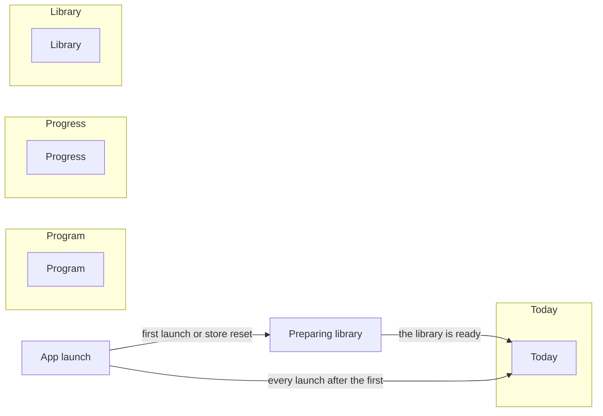
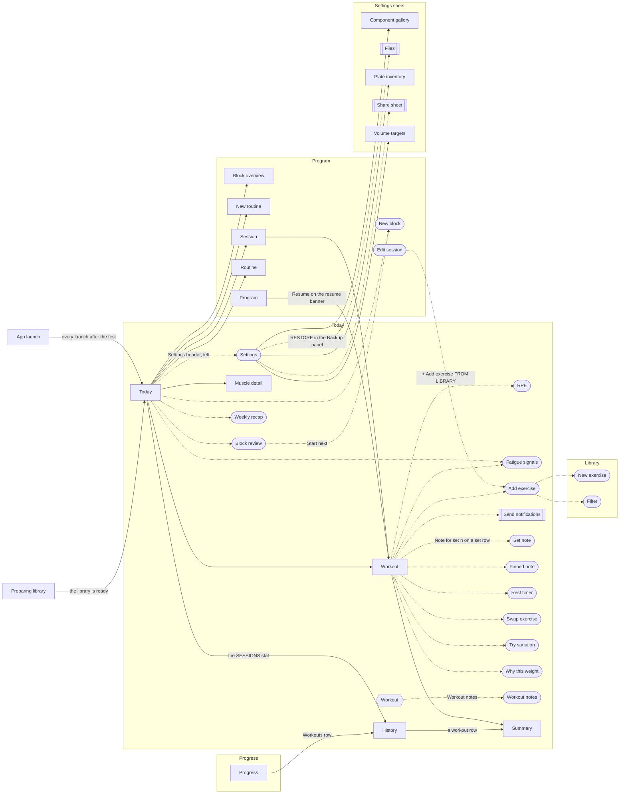
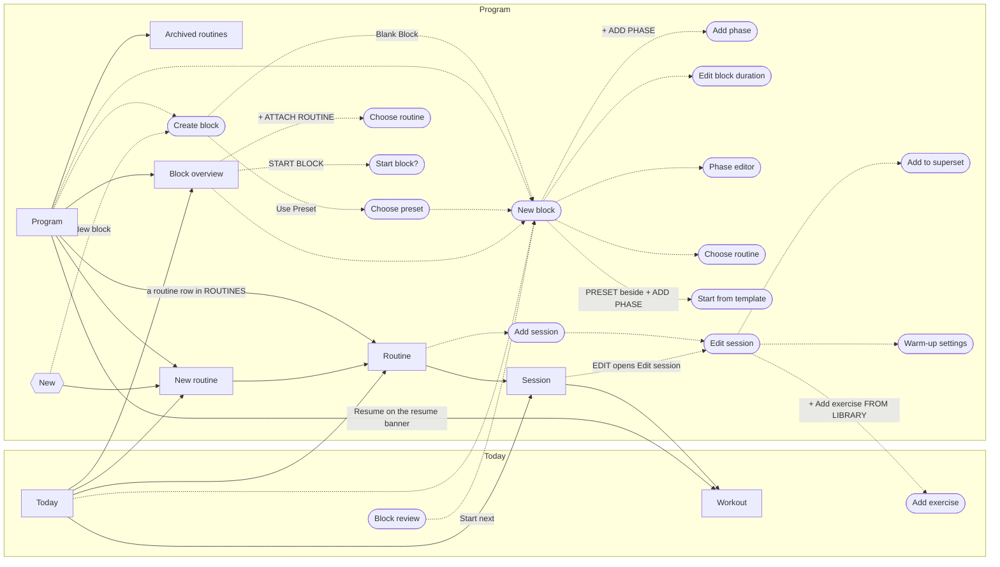
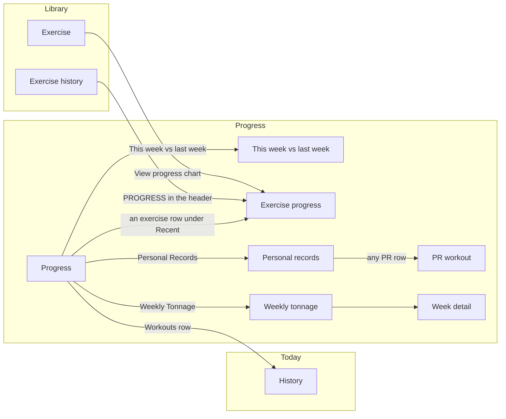
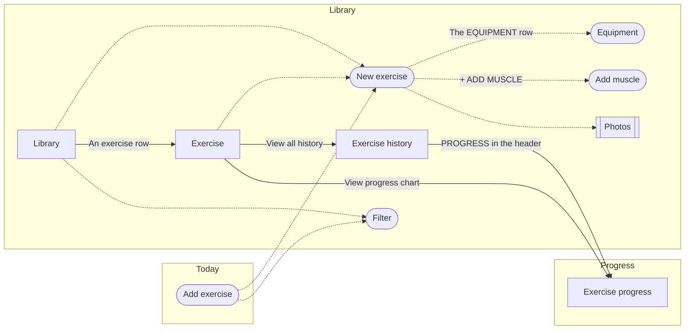
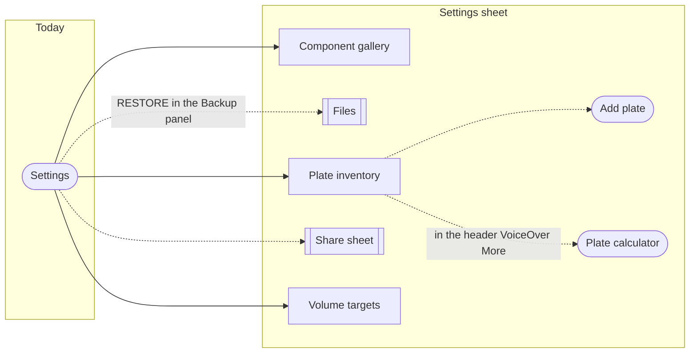
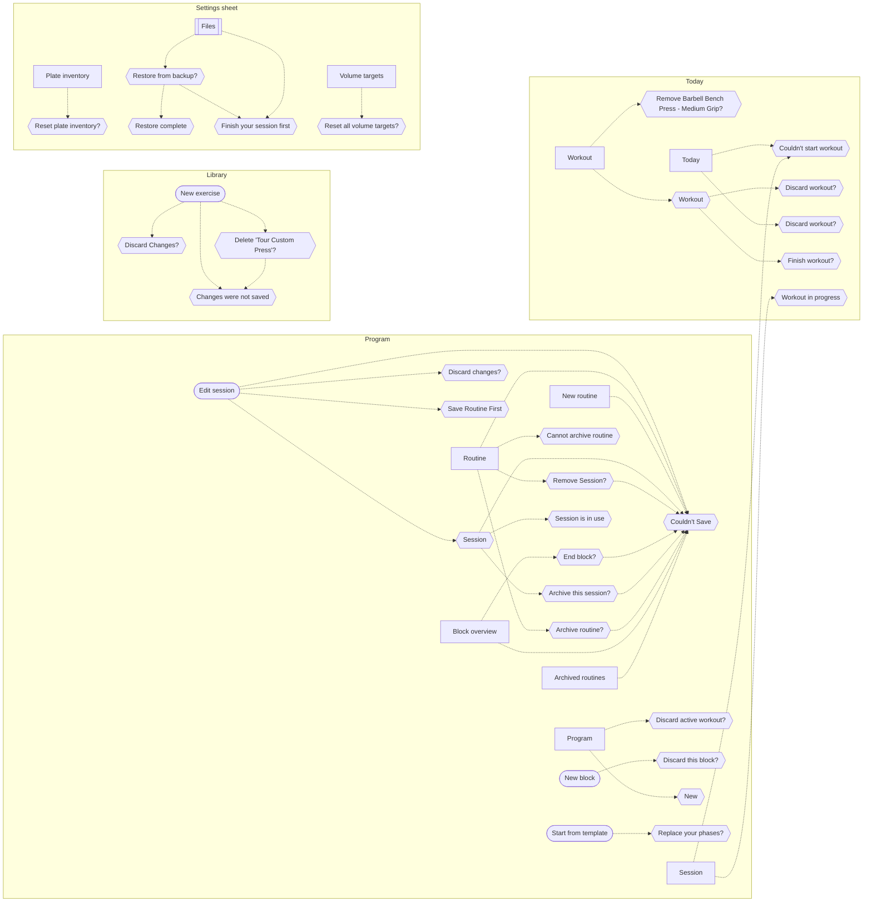

# Navigation

How the lifter reaches every screen, sheet, dialog and system sheet.
A rectangle is a screen, a rounded box is a sheet or a full-screen cover, a hexagon is a dialog or alert, and a box with double sides is drawn by iOS.
A solid arrow pushes a screen, a dotted arrow presents a sheet, cover, dialog or system sheet, and an arrow's label is the control the lifter taps.
The tab bar switches between the four tabs, so tab switches are not drawn.
Each screen file lists the same links under Entry points and Exits, and [conventions.md](conventions.md#mermaid) has the drawing rules.

## Launch and tabs

The app opens on Today, after the exercise library has loaded on the first launch.

## Today

Screens that live in the Today tab, with the screens elsewhere that open them or that they open. A screen that more than one tab reaches lives in the first tab its file lists.

## Program

Screens that live in the Program tab, with the screens elsewhere that open them or that they open. A screen that more than one tab reaches lives in the first tab its file lists.

## Progress

Screens that live in the Progress tab, with the screens elsewhere that open them or that they open. A screen that more than one tab reaches lives in the first tab its file lists.

## Library

Screens that live in the Library tab, with the screens elsewhere that open them or that they open. A screen that more than one tab reaches lives in the first tab its file lists.

## Settings sheet

Settings opens as a sheet from Today, and these screens open inside it.

## Dialogs and alerts

Every dialog and alert, beside the screen that shows it.

