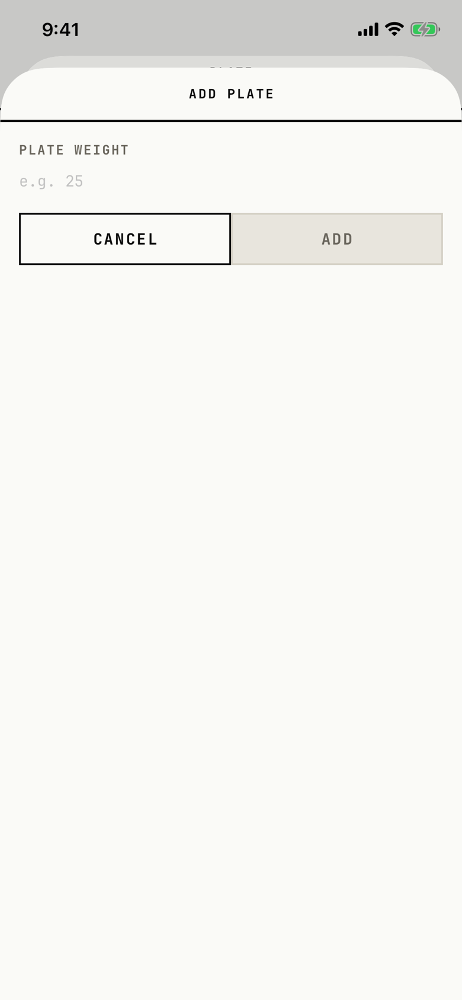

The lifter types the weight of a plate size to add to the open equipment's inventory.

## Entry points

| From | Tap | Kind |
|---|---|---|
| [plate-inventory](plate-inventory.md) | + ADD PLATE under the plate rows, or in the "No plates configured" empty state | sheet |

## Exits

| Control | Goes to | Kind | Closes with |
|---|---|---|---|
| CANCEL | [plate-inventory](plate-inventory.md) | sheet | cancel |
| ADD | [plate-inventory](plate-inventory.md), with the new plate at 2 per side | sheet | verb |
| A swipe down | [plate-inventory](plate-inventory.md) | sheet | cancel |

The sheet opens at full height and has no close control in its header.
The weight field is not focused when the sheet opens, so the lifter taps it before typing.
ADD stays disabled until the field holds a number.

## States

| State | How to reach it | Screenshot |
|---|---|---|
| Empty field, ADD disabled | Plate Inventory > + ADD PLATE | [main](img/17e-default-light-add-plate.png) |
| AX3 | The label, placeholder and buttons grow; the layout stays one column | [ax3](img/17e-ax3-light-add-plate.png) |
| A number typed, ADD enabled | Type a weight; not captured, because the tour cancels at once | not captured |
| "Enter a valid number." | Type text that is not a number, such as "2,5" from a comma decimal pad; not captured | not captured |

Dark mode, the Pro Max at default text and the Pro Max at AX3 change only colour and size: [dark](img/17e-default-dark-add-plate.png), [Pro Max](img/17promax-default-light-add-plate.png), [Pro Max AX3](img/17promax-ax3-light-add-plate.png).

## Compared with the mock-up

No mock-up was drawn for this sheet.

## VoiceOver order

1. ADD PLATE
2. PLATE WEIGHT
3. e.g. 25 (text field)
4. Cancel
5. Add, Disabled

Gaps:

- The field does not say which unit the weight is in; the placeholder "e.g. 25" is its only hint.
- The field is 22 pt tall at default text, but its row spans the sheet's width, so it is easy to hit.
- The plate inventory behind the sheet stays in the tree.

## Findings

- Minor: [D-31](../audit.md#d-31), [D-32](../audit.md#d-32), [D-120](../audit.md#d-120).
- Polish: [D-189](../audit.md#d-189), [D-190](../audit.md#d-190).
