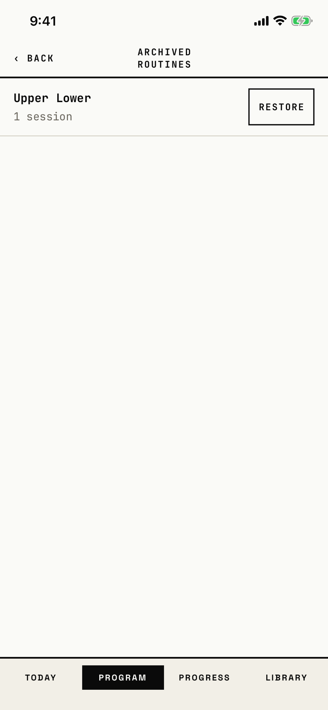

The lifter sees the routines they archived and restores one to the routine lists.

## Entry points

| From | Tap | Kind |
|---|---|---|
| [program](program.md) | Archived routines, the entry Program shows while at least one routine is archived | push |

## Exits

| Control | Goes to | Kind | Closes with |
|---|---|---|---|
| ‹ BACK, or an edge swipe | [program](program.md) | push | back |
| RESTORE on a row | stays here; the row leaves the list and the routine is back on Program | none | verb |
| A failed restore | [dialog-couldnt-save](dialog-couldnt-save.md) | alert | done |

A row cannot be opened; RESTORE is its only action.

## States

| State | How to reach it | Screenshot |
|---|---|---|
| One archived routine | W13 progress seed: build "Upper Lower", Archive routine, Archive, then Program's Archived routines entry | [main](img/17e-default-light-archived-routines.png) |
| One archived empty routine | W15 fresh store: archive an empty "Push Pull Legs", then the Archived routines entry | [with-routine](img/17e-default-light-archived-routines--with-routine.png) |
| Empty after a restore | RESTORE on the only row; "No archived routines." shows | [restored](img/17e-default-light-archived-routines--restored.png) |
| AX3 | The title moves above ‹ BACK, and RESTORE moves under the routine's name and count, on both phones | [ax3](img/17e-ax3-light-archived-routines.png), [Pro Max AX3](img/17promax-ax3-light-archived-routines.png) |

Dark mode and the Pro Max at default text change only colour and size: [dark](img/17e-default-dark-archived-routines.png), [Pro Max](img/17promax-default-light-archived-routines.png), [Pro Max with-routine](img/17promax-default-light-archived-routines--with-routine.png), [Pro Max restored](img/17promax-default-light-archived-routines--restored.png).
At default text on both phones the title wraps to two lines, "ARCHIVED" over "ROUTINES", although the header has no right action.

## Compared with the mock-up

No mock-up was drawn for this screen.

## VoiceOver order

1. BACK
2. Archived routines
3. Upper Lower, 1 session
4. RESTORE UPPER LOWER

Gaps:

- The back button reads "BACK" in capitals.
- RESTORE reads "RESTORE UPPER LOWER" in capitals.

## Findings

<!-- findings are linked after the audit -->
