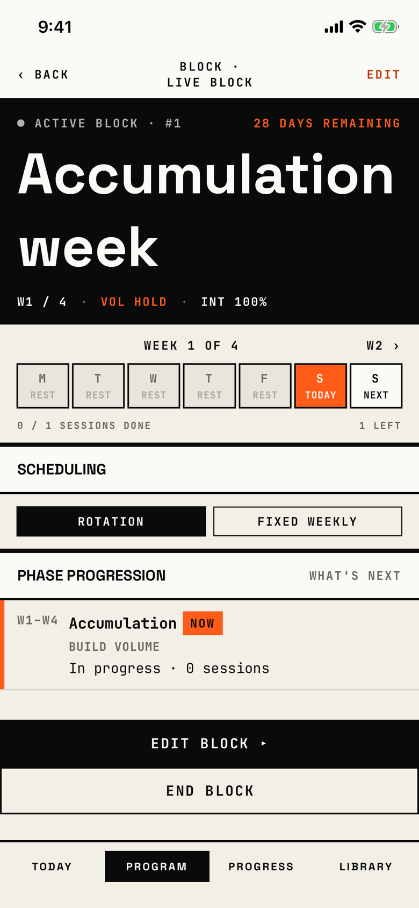

The lifter sees where a block stands, changes its scheduling and routine, and starts, edits or ends it.

## Entry points

| From | Tap | Kind |
|---|---|---|
| [program](program.md) | A block card, such as "ACTIVE block: Live Block", in any status | push |
| [today](today.md) | The active block band, such as LIVE BLOCK | push |

The header title is "Block · " and the block's name, so it changes with each block; the title above uses the main shot's block.

## Exits

| Control | Goes to | Kind | Closes with |
|---|---|---|---|
| ‹ BACK | [program](program.md) or [today](today.md), whichever pushed it | push | back |
| EDIT (header, every status but completed) | [new-block](new-block.md) as Edit block: a cover from Program, a sheet from Today | cover | verb |
| EDIT BLOCK ▸ (active block) | [new-block](new-block.md) as Edit block, the same as the header EDIT | cover | verb |
| END BLOCK (active block) | [dialog-end-block](dialog-end-block.md) | dialog | verb |
| START BLOCK ▸ (ready block, another block active) | [swap-confirm](swap-confirm.md) | sheet | verb |
| START BLOCK ▸ (ready block, no block active) | Stays here; the block starts at once and the page turns active | none | verb |
| + ATTACH ROUTINE ▸ (draft block) or SWAP ▸ (ready block) | [split-picker](split-picker.md) | sheet | verb |
| ROTATION or FIXED WEEKLY, and the day chips | Stays here; the change saves at once | none | none |
| A failed save of a scheduling change | [dialog-couldnt-save](dialog-couldnt-save.md) | dialog | none |

A completed block offers only ‹ BACK; nothing on it opens the block's review.
The "WHAT'S NEXT" and "HISTORY" labels on the section heads are plain text and do nothing.

## States

| State | How to reach it | Screenshot |
|---|---|---|
| Active, from Program | Main tour, active-block seed: Program, the "ACTIVE block: Live Block" card | [17e light](img/17e-default-light-block-overview.png) |
| Active, from Today | W08, active-block seed: Today's LIVE BLOCK band; the same page with Today's tab selected | [17e light active](img/17e-default-light-block-overview--active.png) |
| Completed | W08: END BLOCK, then End Block in the alert; only the phase and session history are left, and EDIT is gone | [17e light completed](img/17e-default-light-block-overview--completed.png) |
| Draft | W10, block-states seed: Program, the DRAFT Autumn Block card; the hero says PICK A ROUTINE, and there is no bottom button | [17e light draft](img/17e-default-light-block-overview--draft.png) |
| Long name, five weeks | W12, powerbuilding seed: the active Powerbuilding card; the header wraps "BLOCK ·" over "POWERBUILDING" | [17e light long name](img/17e-default-light-block-overview--long-name.png) |
| Plan complete | W11, past-plan seed: the active Spring Block past its last week; the hero and the week strip both say PLAN COMPLETE, beside "0 DAYS REMAINING" | [17e light plan complete](img/17e-default-light-block-overview--plan-complete.png) |
| Ready, fixed weekly | W10: the READY Summer Block card; it shows the Routine band with SWAP ▸, the Training days chips and START BLOCK ▸ | [17e light ready](img/17e-default-light-block-overview--ready.png) |
| Active, before its start date | No NOW, current week or progress (not captured; no seed starts a block in the future while active) | - |
| Fatigue advisory strip | Needs three finished workouts with a fatigue signal (not captured; see the states not captured in the assumptions) | - |
| Completed, archive unreadable | "ARCHIVE UNREADABLE" or "NO ARCHIVE AVAILABLE" in place of the history (not captured; no seed makes a broken archive) | - |
| AX3, active | Same walk at AX3: the title sits above ‹ BACK and EDIT, "ACTIVE BLOCK · #1" wraps, the stat row wraps each part over two lines (T108), and the fixed EDIT BLOCK, END BLOCK and two-row tab bar leave a 443 pt scroll area that ends at the week strip | [17e AX3](img/17e-ax3-light-block-overview.png) |
| Pro Max, ready and draft | Same as the ready and draft states; the block name fits one line in the hero, so on a ready block the Deload phase row shows above START BLOCK ▸ | [Pro Max ready](img/17promax-default-light-block-overview--ready.png), [Pro Max draft](img/17promax-default-light-block-overview--draft.png) |
| Pro Max, AX3 | Same walk at AX3; "ACTIVE BLOCK · #1" fits one line, the stat row still wraps each part over two lines, and the week strip turns into a two-column grid of day cells whose first row shows above EDIT BLOCK ▸ | [Pro Max AX3](img/17promax-ax3-light-block-overview.png) |

Dark mode and the Pro Max at default text in the other states change only colour and size: in dark mode the hero and the EDIT BLOCK bar turn into light slabs, as the ink tokens swap ([17e dark](img/17e-default-dark-block-overview.png), [Pro Max](img/17promax-default-light-block-overview.png), [Pro Max active](img/17promax-default-light-block-overview--active.png), [Pro Max completed](img/17promax-default-light-block-overview--completed.png), [Pro Max long name](img/17promax-default-light-block-overview--long-name.png), [Pro Max plan complete](img/17promax-default-light-block-overview--plan-complete.png)).
At default text on both phones, the header title wraps after the "·" for every block name, because the title gets only the middle third of the header row.

## Compared with the mock-up

| In the mock-up | In the app | Difference |
|---|---|---|
| Header "BLOCK · UPPER HYP" on one line, with a bare "‹" and an ink EDIT | "BLOCK ·" over "LIVE BLOCK", "‹ BACK", and EDIT in signal | Title wraps, back is labelled, EDIT takes the accent |
| Hero "INTENSIFICATION WEEK" in condensed caps | "Accumulation week" in the 56 pt display face over two lines | Different face and case |
| Week strip with "‹ W2" and "W4 ›", and each day naming its session, such as PUSH A, with a PR badge | "W2 ›" only, and rest days read REST; days name a session only once a workout is done | Back arrow and session names missing on the first week |
| No scheduling section | SCHEDULING with ROTATION and FIXED WEEKLY chips, and TRAINING DAYS chips in fixed weekly mode | Live controls added |
| Phase rows with results, such as "+18% tonnage · 3 PRs" | Phase rows with "In progress · 0 sessions" or the week count | Results not shown |
| Fatigue advisory strip with DISMISS at the bottom | The strip shows only with a fatigue signal; EDIT BLOCK ▸ and END BLOCK sit at the bottom | Bottom actions added |

## VoiceOver order

1. "BACK"
2. "Block · Live Block"
3. "EDIT"
4. "Active block #1: Live Block, Accumulation week, week 1 of 4, volume hold, intensity 100%, 28 days remaining."
5. "WEEK 1 OF 4", "W2 ›"
6. "Saturday, Accumulation, today"
7. "ROTATION SCHEDULING", selected
8. "EDIT BLOCK ▸", "END BLOCK"

The hero reads as one sentence, and each day as one element, which is right.
"W2 ›" is read as text although it looks like a control.
"WHAT'S NEXT", "HISTORY" and the phase subtitles, such as "BUILD VOLUME", are typed in capitals in the source.
Targets under 44 pt: the scheduling chips are 28 pt tall, the day chips 29 pt, and SWAP ▸ is 47 by 15 pt.
At AX3 the "W1–W4" week label is squeezed to 38 pt wide and breaks over three lines (from the AX3 tree).

## Findings

- Minor: [D-34](../audit.md#d-34), [D-35](../audit.md#d-35), [D-36](../audit.md#d-36), [D-37](../audit.md#d-37), [D-38](../audit.md#d-38), [D-39](../audit.md#d-39), [D-40](../audit.md#d-40), [D-41](../audit.md#d-41), [D-42](../audit.md#d-42), [D-43](../audit.md#d-43), [D-44](../audit.md#d-44), [D-166](../audit.md#d-166).
- Polish: [D-192](../audit.md#d-192), [D-193](../audit.md#d-193), [D-194](../audit.md#d-194), [D-195](../audit.md#d-195), [D-196](../audit.md#d-196), [D-283](../audit.md#d-283).
