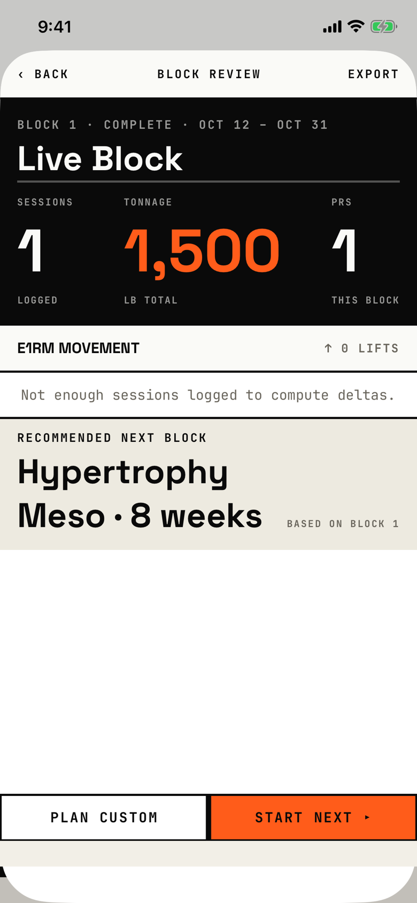

The lifter looks back on a block that ended: workouts logged, tonnage, records and e1RM movement, then starts the next block.

## Entry points

| From | Tap | Kind |
|---|---|---|
| [today](today.md) | nothing; it opens on its own when Today appears and an ended block has not been reviewed | sheet |

## Exits

| Control | Goes to | Kind | Closes with |
|---|---|---|---|
| ‹ BACK (header, left) | [today](today.md) | sheet | back |
| Plan custom | [today](today.md) | sheet | verb |
| Start next ▸ | [new-block](new-block.md) | cover | cancel |

BACK and Plan custom only close the sheet and leave the block unreviewed, so the review opens again the next time Today appears.
Start next ▸ marks the block reviewed and opens New Block with the recommended template.
The weekly recap, when due, opens after this sheet closes.

## States

| State | How to reach it | Screenshot |
|---|---|---|
| One workout in the block | main tour, ended-block-recap seed | [main](img/17e-default-light-block-review.png) |
| Shown again after BACK | W03c, BACK, then Today appears again; matches the main state | [after-back](img/17e-default-light-block-review--after-back.png) |
| Scrolled | W09; the content fits one page, so it matches the main state | [lower](img/17e-default-light-block-review--lower.png) |
| Block ended with no workouts | W08, END BLOCK on an active block with nothing logged | [not-enough-sessions](img/17e-default-light-block-review--not-enough-sessions.png) |
| e1RM rows with deltas and PR marks | not captured: needs at least two logged workouts per lift inside the block, which no seed makes | none |
| AX3 | Same as the main state at AX3; on both phones the title sits on its own line above BACK and EXPORT, the hero stats stack one per row, and the two buttons wrap onto two lines ("PLAN / CUSTOM"; "START / NEXT ▸" on the 17e, "START NEXT / ▸" on the Pro Max), so E1RM MOVEMENT is below the fold | [ax3](img/17e-ax3-light-block-review.png), [Pro Max AX3](img/17promax-ax3-light-block-review.png) |
| Pro Max, every state | Same as each state above, on the Pro Max; the recommended block breaks as "Hypertrophy Meso / · 8 weeks", so its second line starts with "·", and the empty band above the buttons is taller | [Pro Max](img/17promax-default-light-block-review.png), [Pro Max after-back](img/17promax-default-light-block-review--after-back.png), [Pro Max lower](img/17promax-default-light-block-review--lower.png), [Pro Max not-enough-sessions](img/17promax-default-light-block-review--not-enough-sessions.png) |

Dark mode changes colour, and the TONNAGE value stays orange on the light hero panel: [dark](img/17e-default-dark-block-review.png).

## Compared with the mock-up

| In the mock-up | In the app | Difference |
|---|---|---|
| "‹" with BLOCK REVIEW and EXPORT | "‹ BACK", Block review, EXPORT | EXPORT is plain text in the app and does nothing |
| Stats SESSIONS "20 OUT OF 20 · 100%", TONNAGE "284K ↑ 23% VS BLOCK 02", PRS "9 5 LIFTS · 4 EXERCISES" | SESSIONS "1 LOGGED", TONNAGE "1,500 LB TOTAL", PRS "1 THIS BLOCK" | No plan comparison or previous-block delta |
| e1RM movement rows with bars, old → new and PR chips | "Not enough sessions logged to compute deltas." when deltas are missing | Same design when data exists (not captured) |
| Recommended next block band directly above the buttons | Band near the top, then a tall empty area above the buttons | The empty area uses a different background from the page |
| PLAN CUSTOM and START NEXT ▸ at 52 pt | Plan custom and Start next ▸ at 44 pt | Shorter action bar |

## VoiceOver order

1. "BACK" (button)
2. "Block review"
3. "EXPORT"
4. "BLOCK 1 · COMPLETE · OCT 12 – OCT 31"
5. "Live Block"
6. "SESSIONS", "1", "LOGGED"
7. "e1RM movement", "↑ 0 LIFTS"
8. "Plan custom" (button), "Start next ▸" (button)

Gaps: EXPORT is read as text after the title, as if it were part of it.
Each stat cell is read as three loose texts, not one element.
The back button is labelled "BACK" in capitals, unlike "Back" on every other screen.

## Findings

<!-- findings are linked after the audit -->
