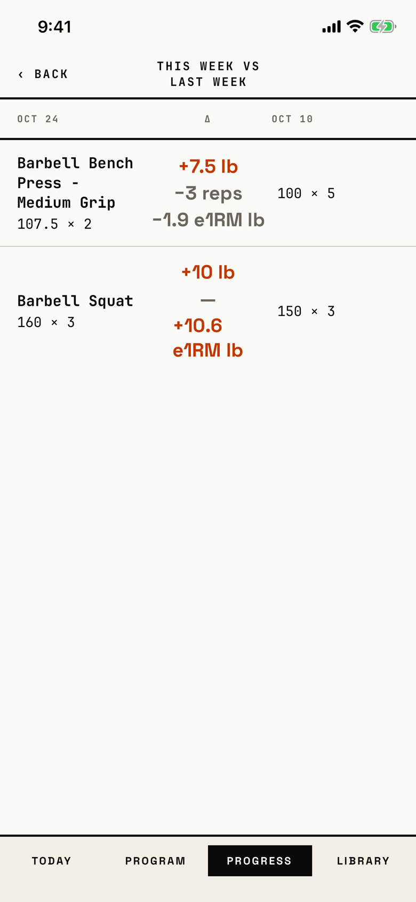

The lifter compares the top set of each exercise in the newest workout with the same session's earlier workout.

## Entry points

| From | Tap | Kind |
|---|---|---|
| [progress](progress.md) | This week vs last week | push |

## Exits

| Control | Goes to | Kind | Closes with |
|---|---|---|---|
| ‹ BACK | [progress](progress.md) | push | back |

## States

| State | How to reach it | Screenshot |
|---|---|---|
| Two exercises, strength against strength | W13 seed: Oct 24 compared with Oct 10, because the earlier match must share the session and the intent | [main](img/17e-default-light-compare.png) |
| An empty workout between two logged ones | W06 seed: Oct 30 against Oct 25, five exercises, all up | [with-empty](img/17e-default-light-compare--with-empty.png) |
| AX3 | The header stacks the title over ‹ BACK; the three columns squeeze the name until "Barbell" breaks inside the word | [ax3](img/17e-ax3-light-compare.png) |
| An exercise with no earlier match | not captured: every seeded exercise has a match; the row reads "<name> - no prior data" | none |
| Empty | not captured: Progress shows the row only when two workouts count; "No comparable session" shows when none of them match | none |
| Pro Max | same as the main state; each change fits on one line ("+10.6 e1RM lb"), so the rows are shorter | [Pro Max](img/17promax-default-light-compare.png) |
| Pro Max, an empty workout between two logged ones | W06 seed; most names wrap onto two lines instead of three | [Pro Max, with-empty](img/17promax-default-light-compare--with-empty.png) |
| Pro Max, AX3 | same as the main state; the header stacks and the changes break across lines as on the 17e, but the name breaks between words, not inside "Barbell" | [Pro Max, AX3](img/17promax-ax3-light-compare.png) |

Dark mode changes only colour: [dark](img/17e-default-dark-compare.png).

## Compared with the mock-up

No mock-up was drawn for this screen.

## VoiceOver order

1. "Back" (button)
2. "This week vs last week" (header)
3. "OCT 24", "Δ", "OCT 10"
4. "Barbell Bench Press - Medium Grip"
5. "107.5 × 2"
6. "+7.5 lb", "−3 reps", "−1.9 e1RM lb"
7. "100 × 5"
8. "No change in reps" for a zero change

Gaps: each row is read as loose fragments with no word for which column a number is in; "Δ" is read as a glyph; the date column labels are 9 pt.

## Findings

- Major: [D-07](../audit.md#d-07).
- Minor: [D-48](../audit.md#d-48), [D-49](../audit.md#d-49).
- Polish: [D-204](../audit.md#d-204), [D-205](../audit.md#d-205), [D-206](../audit.md#d-206).
