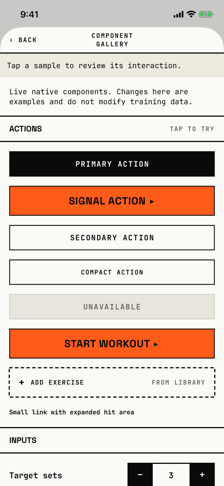

The developer taps live samples of the shared BRU components to check their look and feedback; nothing here changes training data.

## Entry points

| From | Tap | Kind |
|---|---|---|
| [settings](settings.md) | Component gallery ("Live examples ›") in the DEVELOPER section | push |

The DEVELOPER section and this screen exist only in Debug builds.
The row is wrapped in `#if DEBUG` at `fitbod/Settings/SettingsView.swift:90`, and the whole gallery file is inside `#if DEBUG` from `fitbod/Design/BRUComponentGallery.swift:4`, so a Release build shows neither.
The tour runs a Debug build, which is why the section shows in its Settings shots.

## Exits

| Control | Goes to | Kind | Closes with |
|---|---|---|---|
| ‹ BACK | [settings](settings.md) | push | back |
| Any sample | this screen; the band under the header names the last action | none | none |

## States

| State | How to reach it | Screenshot |
|---|---|---|
| Top of the gallery, no sample tapped | Settings > Component gallery | [main](img/17e-default-light-component-gallery.png) |
| AX3 | On both phones the title moves above ‹ BACK, and the intro text fills most of the first screen | [ax3](img/17e-ax3-light-component-gallery.png), [Pro Max AX3](img/17promax-ax3-light-component-gallery.png) |
| A sample tapped | Tap any sample; the band reads its name; not captured | not captured |

Dark mode and the Pro Max at default text change only colour and size: [dark](img/17e-default-dark-component-gallery.png), [Pro Max](img/17promax-default-light-component-gallery.png).
On the Pro Max the title still wraps to "COMPONENT / GALLERY", as on the 17e.
The gallery scrolls on through Inputs, Chips and wrapping, Set completion and more; the tour shot only the top.

## Compared with the mock-up

No mock-up was drawn for this screen.

## VoiceOver order

1. Back
2. Component gallery
3. Tap a sample to review its interaction.
4. Live native components. Changes here are examples and do not modify training data.
5. Actions, Tap to try
6. Primary action
7. Signal action ▸
8. Add exercise

Gaps:

- The dashed Add exercise slot is labelled only "Add exercise", so its "From library" hint is not part of the label.
- The PR and DL badges in the chips section are 9 pt tall texts.

## Findings

- Polish: [D-207](../audit.md#d-207), [D-208](../audit.md#d-208), [D-295](../audit.md#d-295).
