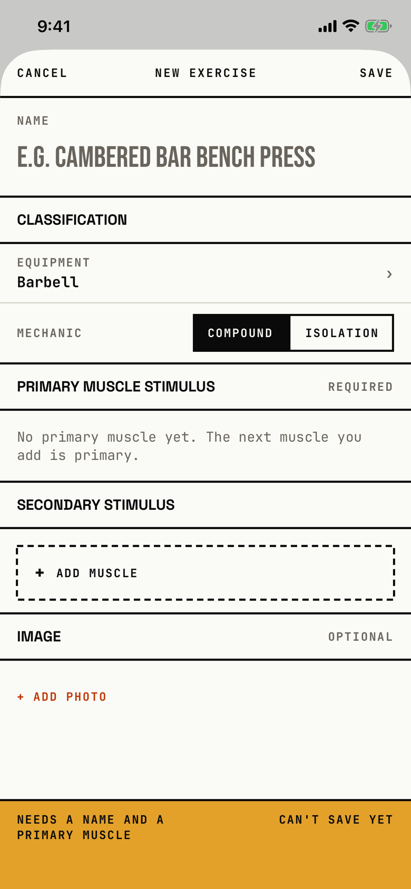

The lifter names a new exercise, sets its equipment, mechanic and muscle stimulus, and saves it to the Library, or edits or deletes one they made.

## Entry points

| From | Tap | Kind |
|---|---|---|
| [library](library.md) | + NEW, or CREATE CUSTOM EXERCISE in the no-match state | sheet |
| [library-picker](library-picker.md) | + NEW in the exercise picker; the saved exercise then shows in the picker's list | sheet |
| [exercise-detail](exercise-detail.md) | COPY or COPY AS CUSTOM EXERCISE on a built-in, or EDIT on a custom exercise | sheet |

The title is "New exercise" for a new or copied exercise and "Edit exercise" for an existing custom one.

## Exits

| Control | Goes to | Kind | Closes with |
|---|---|---|---|
| CANCEL, with no changes | the screen behind | sheet | cancel |
| CANCEL, with changes | [dialog-custom-exercise-discard](dialog-custom-exercise-discard.md) | dialog | verb |
| SAVE, with a name and a primary at 0.5 or more | the screen behind, with the exercise saved | sheet | verb |
| SAVE, when the save fails | [dialog-changes-not-saved](dialog-changes-not-saved.md) | alert | done |
| The EQUIPMENT row | [equipment-picker](equipment-picker.md) | sheet | cancel |
| + ADD MUSCLE | [muscle-picker](muscle-picker.md) | sheet | cancel |
| + ADD PHOTO | [photos-picker](photos-picker.md) | system | cancel |
| DELETE EXERCISE, when editing | [dialog-delete-exercise](dialog-delete-exercise.md) | alert | verb |

A swipe down is blocked while the form has changes, so the discard dialog cannot be skipped.
A failed save rolls the store back; the orchestrator's blocker row on Remove Session describes how that rollback also drops a refused Remove Session that is still pending.

## States

| State | How to reach it | Screenshot |
|---|---|---|
| Main: empty name with the placeholder "e.g. Cambered Bar Bench Press", Barbell, Compound, no muscles, amber footer "NEEDS A NAME AND A PRIMARY MUSCLE · CAN'T SAVE YET" | W13 (Main): Library > + NEW | [main](img/17e-default-light-custom-exercise.png) |
| New from a search: the name starts as "Zercher Probe", footer "NEEDS A PRIMARY MUSCLE" | W01: no-match > CREATE CUSTOM EXERCISE | [new](img/17e-default-light-custom-exercise--new.png) |
| Validation: "Enter an exercise name." and "At least one primary muscle is required to save." | W01: name cleared > SAVE | [validation](img/17e-default-light-custom-exercise--validation.png) |
| Edit: "Edit exercise", PRIMARY CHEST with 0.25 to 1 weight boxes, REMOVE, an orange footer "VALID · 1 PRIMARY MAPPED · READY TO SAVE", DELETE EXERCISE below | W01: custom detail > EDIT | [edit](img/17e-default-light-custom-exercise--edit.png) |
| A copy of a built-in: name "<name> (Copy)" and the built-in's muscles | Not captured: the tour does not tap COPY | - |
| A primary below 0.5: "A primary muscle needs a weight of 0.5 or more to save." | Not captured: the tour keeps Chest at 1 | - |
| With a photo: CHANGE PHOTO and REMOVE PHOTO | Not captured: the simulator photo library is not driven | - |
| AX3, on both phones: the header puts NEW EXERCISE above CANCEL and SAVE, MECHANIC moves above its control, section heads wrap, and the footer stacks into three lines that fill about a fifth of the screen | Main launch at AX3 | [AX3](img/17e-ax3-light-custom-exercise.png), [Pro Max, AX3](img/17promax-ax3-light-custom-exercise.png) |
| Pro Max: the footer "NEEDS A NAME AND A PRIMARY MUSCLE" fits on one line, where the 17e wraps it over two | same as Main | [Pro Max](img/17promax-default-light-custom-exercise.png) |
| Pro Max, validation: "At least one primary muscle is required to save." fits on one line | same as Validation | [Pro Max, validation](img/17promax-default-light-custom-exercise--validation.png) |
| Pro Max, edit: DELETE EXERCISE sits whole above the footer on the first screen, where the 17e footer covers it until the lifter scrolls | same as Edit | [Pro Max, edit](img/17promax-default-light-custom-exercise--edit.png) |

Dark mode and the Pro Max in the New state change only colour and size: [dark](img/17e-default-dark-custom-exercise.png), [Pro Max, new](img/17promax-default-light-custom-exercise--new.png).

## Compared with the mock-up

| In the mock-up | In the app | Difference |
|---|---|---|
| Classification is a two-column grid: Equipment, Mechanic, Pattern, Tempo, Bar wt, Increment | An Equipment row and a Mechanic segmented control | Pattern, Tempo, bar weight and increment are not here; bar weight and increment live on [exercise-detail](exercise-detail.md). |
| Every muscle row has a PRIMARY or SECONDARY tag and its weight boxes on one line | The tag and name on one line, the weight boxes and percent below | Rows take two lines. |
| + ADD MUSCLE sits after all muscles | + ADD MUSCLE sits under SECONDARY STIMULUS, even for the first, primary muscle | The only add control is in the secondary section. |
| An orange status footer above a black SAVE EXERCISE ▸ bar | A status footer only, amber when the form cannot save and orange when it can; SAVE is in the header | No bottom save button. |
| No image section | IMAGE, OPTIONAL with + ADD PHOTO | The app adds a photo. |

## VoiceOver order

1. "Cancel"
2. "New exercise"
3. "Save"
4. The name field, read only as its placeholder "e.g. Cambered Bar Bench Press"
5. "Equipment", value "Barbell"
6. "Compound", selected, and "Isolation"
7. "Add Primary Muscle"
8. "Needs a name and a primary muscle. Can't save yet."

Gaps: the name field has no label, because its visible NAME label is hidden from VoiceOver, and it is 35 pt tall.
The add control reads "Add Primary Muscle" while it shows "+ ADD MUSCLE" in the secondary section.
The weight boxes are 44 by 44 pt and read as percentages.

## Findings

- Minor: [D-50](../audit.md#d-50), [D-51](../audit.md#d-51), [D-52](../audit.md#d-52), [D-53](../audit.md#d-53).
- Polish: [D-209](../audit.md#d-209), [D-210](../audit.md#d-210), [D-215](../audit.md#d-215).
