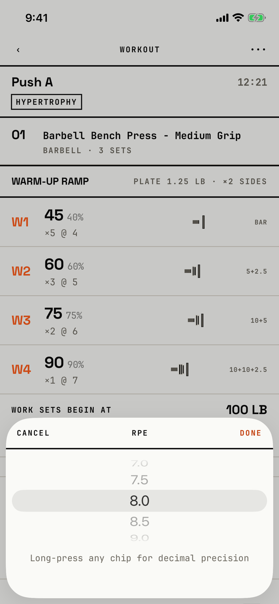

The lifter picks an RPE in half steps, such as 8.5, when the whole-number chips are not precise enough.

## Entry points

| From | Tap | Kind |
|---|---|---|
| [logger](logger.md) | A long press on any RPE chip of a set | sheet |

## Exits

| Control | Goes to | Kind | Closes with |
|---|---|---|---|
| Cancel | [logger](logger.md), with the RPE unchanged | sheet | cancel |
| Done | [logger](logger.md), with the picked RPE on the set | sheet | done |
| A swipe down | [logger](logger.md), with the RPE unchanged | sheet | cancel |

The sheet is 30% of the screen tall: a Cancel, RPE, Done header, iOS's wheel picker, and a muted line "Long-press any chip for decimal precision".
Its header strings are written in title case, so VoiceOver reads "Cancel" and "Done", where the other logger sheets' strings are typed in capitals.

## States

| State | How to reach it | Screenshot |
|---|---|---|
| Open on the chip's value | W03 demo: long press RPE 8 on set 1 | [main](img/17e-default-light-decimal-rpe-picker.png) |
| AX3 | On both phones the wheel and header grow, and the hint line is cut off inside the fixed 30% height, to "Long-press any chip…" on the 17e and "Long-press any chip fo…" on the Pro Max | [ax3](img/17e-ax3-light-decimal-rpe-picker.png), [Pro Max ax3](img/17promax-ax3-light-decimal-rpe-picker.png) |

Dark mode and the Pro Max at default text change only colour and size: [dark](img/17e-default-dark-decimal-rpe-picker.png), [Pro Max](img/17promax-default-light-decimal-rpe-picker.png).

## Compared with the mock-up

No mock-up exists for this sheet.

## VoiceOver order

1. Cancel
2. RPE
3. Done
4. RPE (the wheel)
5. Long-press any chip for decimal precision

Gaps:

- The hint tells the lifter how to open the sheet they are already in.
- The wheel is iOS's own picker, the one piece of system chrome in the logger's sheets.

## Findings

- Polish: [D-211](../audit.md#d-211).
