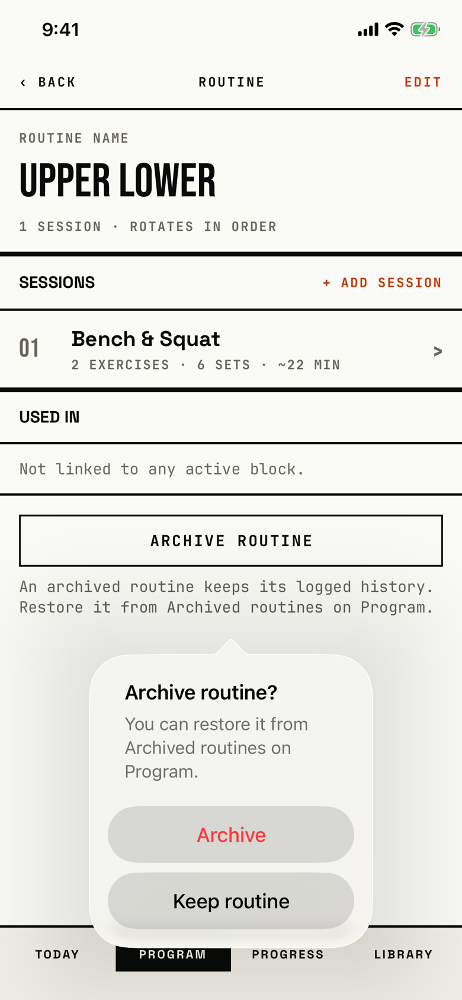

The lifter confirms that a routine no block uses moves to Archived routines.

## Trigger

| From | Tap | Kind |
|---|---|---|
| [routine-editor](routine-editor.md) | ARCHIVE ROUTINE at the foot of the page, when no unfinished block uses the routine | dialog |

The deny rule runs first: when a draft, ready or active block uses the routine, [dialog-cannot-archive-routine](dialog-cannot-archive-routine.md) shows instead.
The routine editor opens from Program and from Today.
The tour built "Upper Lower" on the progress-history seed and tapped ARCHIVE ROUTINE.

## Buttons

| Button | Role | Does | Closes with |
|---|---|---|---|
| Archive | destructive | Archives the routine and closes the routine editor; a failed save shows [dialog-couldnt-save](dialog-couldnt-save.md) | verb |
| Keep routine | default | Closes the dialog | verb |

Keep routine has no role, because iOS 26 hides a cancel-role button; a tap outside also closes the dialog.

## Copy check

- The message says how to undo the archive and names Program, the right tab.
- The caption under the button already says the same thing, so the lifter reads it twice.
- "Keep routine" follows the "Keep ..." pattern of the other dialogs.

## Screenshot

| State | How to reach it | Screenshot |
|---|---|---|
| Main | Walk-built "Upper Lower", ARCHIVE ROUTINE | [light](img/17e-default-light-dialog-archive-routine.png) |
| Empty routine, about to archive | Walk W15: a new "Push Pull Legs" with no session, ARCHIVE ROUTINE; the walk then taps Archive | [light](img/17e-default-light-dialog-archive-routine--confirmed.png) |
| Dark | Main state, in dark mode | [dark](img/17e-default-dark-dialog-archive-routine.png) |
| AX3 | Main state at AX3; on both phones the dialog grows over the button, 605 pt tall on the 17e, and its arrow points up above ARCHIVE ROUTINE, at the session row on the 17e and at the routine summary on the Pro Max | [AX3](img/17e-ax3-light-dialog-archive-routine.png), [Pro Max AX3](img/17promax-ax3-light-dialog-archive-routine.png) |
| Pro Max, empty routine | Same as the empty routine above, on the Pro Max; the dialog sits below ARCHIVE ROUTINE and leaves it visible, while on the 17e it covers the button and its arrow points at the Used in row | [Pro Max](img/17promax-default-light-dialog-archive-routine--confirmed.png) |

The `--confirmed` image shows the dialog before Archive is tapped, on an empty routine.
Dark mode and the Pro Max at default text change only colour and size: [dark](img/17e-default-dark-dialog-archive-routine.png), [Pro Max](img/17promax-default-light-dialog-archive-routine.png).

VoiceOver order, from the tree:

1. "Archive routine?"
2. "You can restore it from Archived routines on Program."
3. "Archive", button
4. "Keep routine", button

The buttons are 208 by 48 pt, and nothing is unlabelled.

## Findings

<!-- findings are linked after the audit -->
