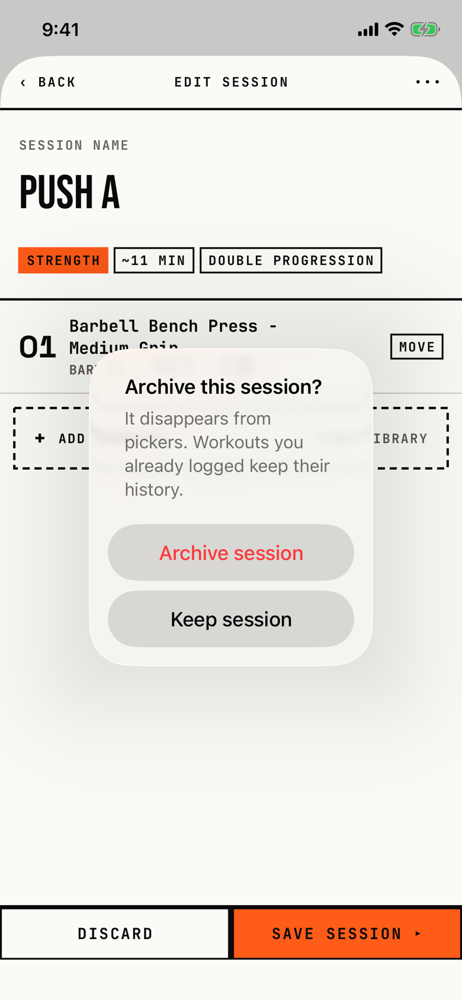

The lifter confirms archiving a session that no routine uses.

## Trigger

In [session-editor](session-editor.md), the lifter taps ••• and then Archive session in [dialog-session-menu](dialog-session-menu.md).
It shows only when no routine, active or archived, holds the session (`fitbod/Routines/RoutineBuilderView.swift:600`); otherwise [dialog-session-in-use](dialog-session-in-use.md) shows.
Because Remove Session always fails (see the orchestrator's blocker row), a session that was ever in a routine cannot reach this dialog in a normal run.
The tour reached it in W15 by keeping Push A's detail open on Today while Program tried to remove it, then archiving from Today.

## Buttons

| Button | Role | Result |
|---|---|---|
| Archive session | destructive, red | Marks the session archived, saves and closes the editor; a failed save shows [dialog-couldnt-save](dialog-couldnt-save.md). |
| Keep session | plain | Closes the dialog. |

iOS 26 hides a cancel-role button, so the code uses a plain Keep session; a tap outside the popover also closes it.
Both buttons are 208 by 48 pt.

## Copy check

- Sentence case; "Workouts you already logged" uses the right word for logged workouts.
- "It disappears from pickers" uses a developer word; the lifter knows these as the Add session list and Today's start list.
- It does not say how to bring an archived session back, while the archive-routine copy does ("Restore it from Archived routines on Program").

## Screenshot

| State | How to reach it | Screenshot |
|---|---|---|
| Main | W15, Push A taken out of its routine, then Today, Push A, Edit, More, Archive session | [image](img/17e-default-light-dialog-archive-session.png) |

The Pro Max at default text changes only size: [Pro Max](img/17promax-default-light-dialog-archive-session.png).
Walk-only dialog, so no dark or AX3 capture exists.

## Findings

- Polish: [D-213](../audit.md#d-213), [D-227](../audit.md#d-227).
