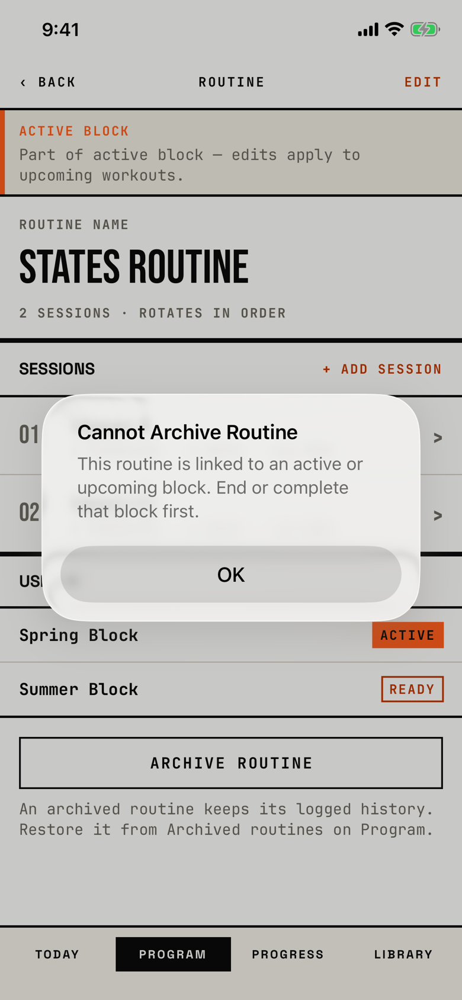

The lifter tries to archive a routine that an unfinished block still uses, and the app refuses.

## Trigger

| From | Tap | Kind |
|---|---|---|
| [routine-editor](routine-editor.md) | ARCHIVE ROUTINE, when a draft, ready or active block uses the routine | alert |

The rule refuses the archive for any block that is not completed (`fitbod/Models/SplitDeletionGuard.swift:41`).
ARCHIVE ROUTINE looks the same whether or not the archive will be refused.
The tour opened "States Routine" on the block-states seed, which an active, a ready and a draft block use, and tapped ARCHIVE ROUTINE (walk W10).

## Buttons

| Button | Role | Does | Closes with |
|---|---|---|---|
| OK | cancel | Closes the alert; nothing changes | cancel |

## Copy check

- The title "Cannot Archive Routine" is in title case, while every other dialog in this group uses sentence case, and the save errors say "Couldn't".
- The message tells the lifter to "end or complete that block", but only an active block can be ended (`fitbod/Periodization/BlockLifecycleService.swift:125`); a ready or draft block must be deleted or given another routine, which the alert does not say.
- "Upcoming" covers the ready block, and the draft block is not named at all.

## Screenshot

| State | How to reach it | Screenshot |
|---|---|---|
| Main | Block-states seed, States Routine, ARCHIVE ROUTINE | [light](img/17e-default-light-dialog-cannot-archive-routine.png) |

The Pro Max at default text changes only size: [Pro Max](img/17promax-default-light-dialog-cannot-archive-routine.png).
The tour reaches this alert only in a walk, so it has no dark or AX3 capture.

VoiceOver order, from the tree:

1. "Cannot Archive Routine"
2. "This routine is linked to an active or upcoming block. End or complete that block first."
3. "OK", button

The button is 288 by 48 pt, and nothing is unlabelled.

## Findings

- Minor: [D-54](../audit.md#d-54).
- Polish: [D-214](../audit.md#d-214).
