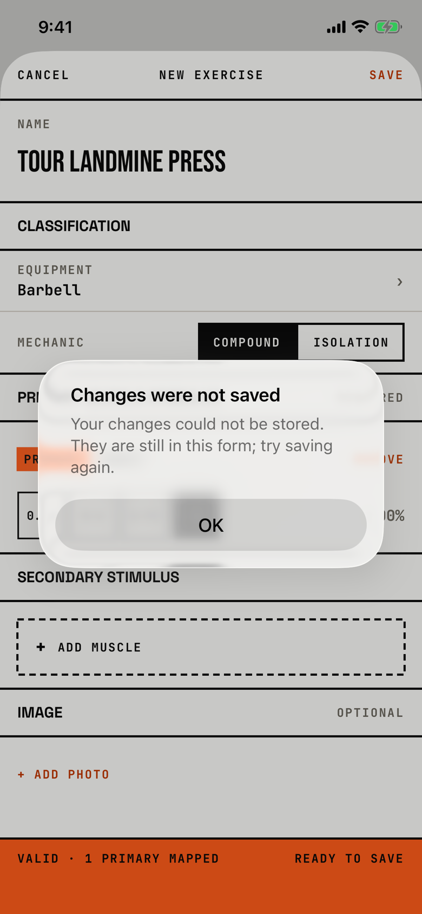

The lifter learns that a custom exercise could not be saved or deleted.

## Trigger

In [custom-exercise](custom-exercise.md), SAVE fails (`fitbod/ExerciseLibrary/CustomExerciseEditor.swift:511`), or Delete in [dialog-delete-exercise](dialog-delete-exercise.md) fails (`fitbod/ExerciseLibrary/CustomExerciseEditor.swift:528`).
The editor rolls the store back after the failure.
The tour reached it in W15 right after the failed Remove Session, because the pending delete makes every later save fail; this is the orchestrator's blocker row.
The rollback also drops that pending delete, so the next save works.

## Buttons

| Button | Role | Result |
|---|---|---|
| OK | cancel | Closes the alert; the form keeps what the lifter typed. |

OK is 288 by 48 pt.

## Copy check

- The save message is clear and says the form still holds the edits.
- After a failed delete the same title shows with "The exercise could not be deleted. Try again.", so the title talks about changes when the lifter asked to delete.
- The routine and session screens report the same kind of failure as "Couldn't Save" or "Couldn't save" ([dialog-couldnt-save](dialog-couldnt-save.md)).

## Screenshot

| State | How to reach it | Screenshot |
|---|---|---|
| Main | W15, after the failed Remove Session, Library, + New, "Tour Landmine Press" with Chest, SAVE | [image](img/17e-default-light-dialog-changes-not-saved.png) |
| Delete failed | not captured: needs a failed delete, which no walk causes | - |

The Pro Max at default text changes only size: [Pro Max](img/17promax-default-light-dialog-changes-not-saved.png).
Walk-only dialog, so no dark or AX3 capture exists.

## Findings

- Blocker: [D-02](../audit.md#d-02).
- Polish: [D-215](../audit.md#d-215).
