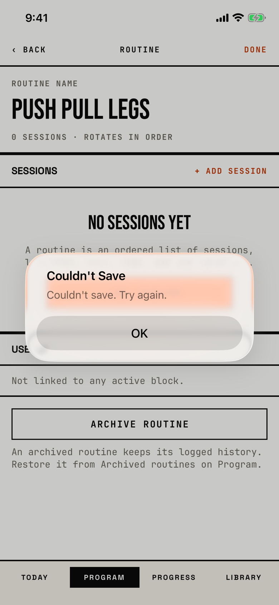

The lifter learns that a change to the program was not stored.

## Trigger

Five screens draw their own copy of this alert when a store save fails:

| Where | Title | Message | Code |
|---|---|---|---|
| [routine-editor](routine-editor.md): rename, reorder, Remove Session, Archive routine | Couldn't Save | Couldn't save. Try again. | `fitbod/Periodization/SplitDetailView.swift:179` |
| [new-routine](new-routine.md): Save | Couldn't Save | Couldn't save. Try again. | `fitbod/Routines/NewRoutineNameScreen.swift:87` |
| [archived-routines](archived-routines.md): Restore | Couldn't Save | Couldn't save. Try again. | `fitbod/Periodization/ArchivedRoutinesView.swift:71` |
| [block-overview](block-overview.md): End Block in [dialog-end-block](dialog-end-block.md), and other edits | Couldn't Save | Couldn't save. Try again. | `fitbod/Periodization/BlockOverviewScreen.swift:334` |
| [session-editor](session-editor.md): SAVE SESSION, Duplicate session, Archive session | Couldn't save | the raw system error text | `fitbod/Routines/RoutineBuilderView.swift:268` |

The screenshot is the routine screen's copy, after Remove Session in [dialog-remove-session](dialog-remove-session.md).
That save fails every time, and later saves stay stuck until the app restarts; this is the orchestrator's blocker row on Remove Session.

## Buttons

| Button | Role | Result |
|---|---|---|
| OK | cancel | Closes the alert. The failed change stays pending in memory, so the screen can show a state the store does not hold. |

OK is 288 by 48 pt.

## Copy check

- The message repeats the title ("Couldn't Save" then "Couldn't save.") and adds only "Try again", which does not help while saves are stuck.
- The session editor's copy uses sentence case ("Couldn't save") and shows the system's error text, while the four others use Title Case and a fixed message.
- None of them says what was not saved.

## Screenshot

| State | How to reach it | Screenshot |
|---|---|---|
| Main | W15, Push Pull Legs routine, Edit, REMOVE on Push A, Remove Session | [image](img/17e-default-light-dialog-couldnt-save.png) |
| Session editor copy | not captured: needs a failed save inside the session editor, which no walk causes | - |

The Pro Max at default text changes only size: [Pro Max](img/17promax-default-light-dialog-couldnt-save.png).
Walk-only dialog, so no dark or AX3 capture exists.

## Findings

<!-- findings are linked after the audit -->
