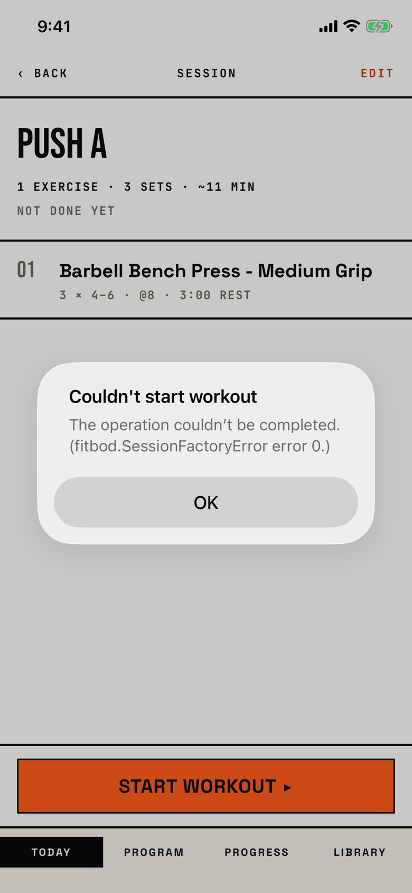

The lifter taps Start workout and the app tells them the workout could not be created.

## Trigger

| From | Tap | Kind |
|---|---|---|
| [today](today.md) | A session's start control, when the start fails | alert |
| [session-template-detail](session-template-detail.md) | Start workout ▸, when the start fails | alert |

Both screens draw the same alert: Today at `fitbod/Views/TodayView.swift:356`, the session screen at `fitbod/Routines/SessionTemplateDetailView.swift:86`.
The message is either "Add at least one exercise to ... first." for an empty session, or the raw text of the save error (`fitbod/Views/TodayView.swift:593`, `fitbod/Routines/SessionTemplateDetailView.swift:216`).
The empty-session message cannot show, because a session cannot be saved without an exercise and the session screen disables Start workout ▸ when it has none.
The tour reached the save-error case in walk W15: after Remove Session failed in the routine editor, the refused delete stayed pending and the next Start workout ▸ failed too.
That is the orchestrator's blocker row for this screen, which also covers how the store recovers.

## Buttons

| Button | Role | Does | Closes with |
|---|---|---|---|
| OK | cancel | Closes the alert; nothing was created | cancel |

## Copy check

- The message is the system's raw error, "The operation couldn't be completed. (fitbod.SessionFactoryError error 0.)", which names a code type and gives no next step; the orchestrator's table already holds this.
- The title types a straight apostrophe, while the system message uses a curly one, so the two lines differ.
- The title uses the app's word, workout.

## Screenshot

| State | How to reach it | Screenshot |
|---|---|---|
| Save error | Walk W15: Remove Session fails, then Start workout ▸ on Push A | [light](img/17e-default-light-dialog-couldnt-start-workout.png) |
| Empty session | Not captured: a session cannot be saved without an exercise | - |

The Pro Max at default text changes only size: [Pro Max](img/17promax-default-light-dialog-couldnt-start-workout.png).
The tour reaches this alert only in a walk, so it has no dark or AX3 capture.

VoiceOver order, from the tree:

1. "Couldn't start workout"
2. "The operation couldn't be completed. (fitbod.SessionFactoryError error 0.)"
3. "OK", button

VoiceOver reads the code type name aloud.

## Findings

- Blocker: [D-02](../audit.md#d-02).
- Major: [D-08](../audit.md#d-08).
- Polish: [D-217](../audit.md#d-217), [D-218](../audit.md#d-218).
