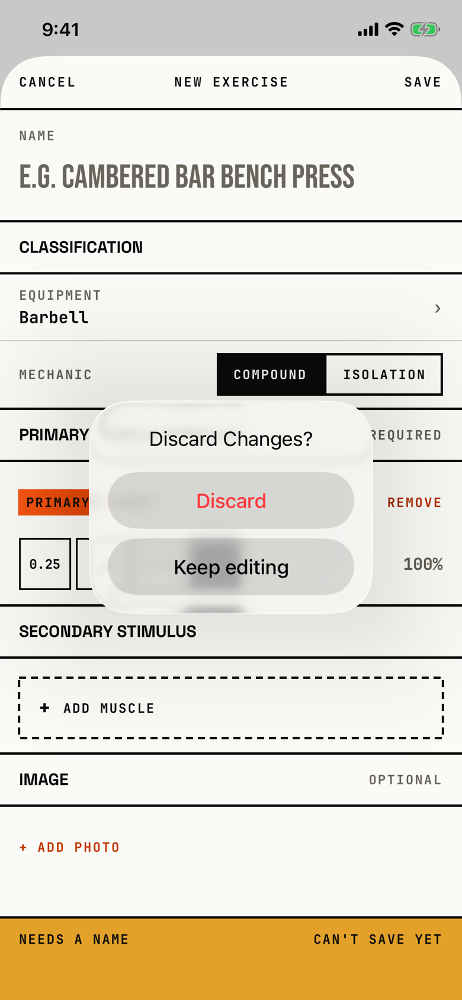

The lifter decides whether to throw away a new or edited custom exercise.

## Trigger

In [custom-exercise](custom-exercise.md) with changes, the lifter taps CANCEL in the header (`fitbod/ExerciseLibrary/CustomExerciseEditor.swift:484`).
With no changes, CANCEL closes the editor at once, and a swipe down is blocked while there are changes.

## Buttons

| Button | Role | Result |
|---|---|---|
| Discard | destructive, red | Closes the editor without saving. |
| Keep editing | plain | Closes the dialog. |

iOS 26 hides a cancel-role button, so the code uses a plain Keep editing; a tap outside the popover also closes it.
Both buttons are 208 by 48 pt, and 322 by 82.7 pt at AX3.

## Copy check

- The title is in Title Case ("Discard Changes?"), while the session editor asks the same thing in sentence case ("Discard changes?").
- Unlike the session editor's dialog, it has no message saying the edits will be lost.
- The popover floats over the middle of the form and points at nothing the lifter tapped.

## Screenshot

| State | How to reach it | Screenshot |
|---|---|---|
| Main | Main tour, Library, + New, Chest as primary muscle, CANCEL | [image](img/17e-default-light-dialog-custom-exercise-discard.png) |
| AX3 | Main tour at AX3 | [image](img/17e-ax3-light-dialog-custom-exercise-discard.png) |
| Pro Max, AX3 | Main tour at AX3 on the Pro Max; the title stays on one line | [Pro Max AX3](img/17promax-ax3-light-dialog-custom-exercise-discard.png) |

On the 17e at AX3 the title wraps to two lines, and on both phones at AX3 the popover covers most of the form.
Dark mode and the Pro Max at default text change only colour and size: [dark](img/17e-default-dark-dialog-custom-exercise-discard.png), [Pro Max](img/17promax-default-light-dialog-custom-exercise-discard.png).

## Findings

<!-- findings are linked after the audit -->
