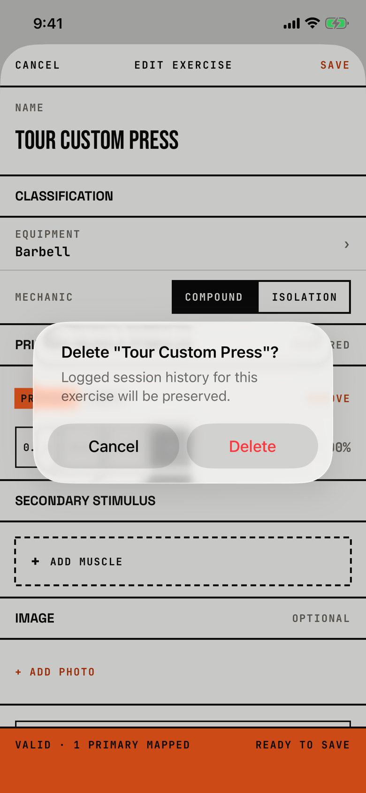

The lifter confirms deleting a custom exercise.

## Trigger

In [custom-exercise](custom-exercise.md) while editing a saved custom exercise ("Edit exercise"), the lifter scrolls down and taps "Delete exercise".
The title holds the exercise's name in straight double quotes, as in Delete "Tour Custom Press"?.

## Buttons

| Button | Role | Result |
|---|---|---|
| Cancel | cancel | Closes the alert. |
| Delete | destructive, red | Deletes the exercise and closes the editor; a failed delete shows [dialog-changes-not-saved](dialog-changes-not-saved.md). |

This is an alert, so Cancel stays visible.
Both buttons are 140 by 48 pt side by side, and 157 by 96 pt at AX3.

## Copy check

- It names the exercise, which the routine dialogs do not do.
- "Logged session history" calls logged workouts sessions; in the app's words they are workouts.
- It does not say where the exercise disappears from (the library, sessions that use it).
- Other destructive confirmations in this area use a confirmation dialog with a "Keep" button; this one is an alert with Cancel.

## Screenshot

| State | How to reach it | Screenshot |
|---|---|---|
| Main | Main tour, save "Tour Custom Press", open it, Edit, Delete exercise | [image](img/17e-default-light-dialog-delete-exercise.png) |
| AX3 | Main tour at AX3, the same on both phones | [image](img/17e-ax3-light-dialog-delete-exercise.png), [Pro Max AX3](img/17promax-ax3-light-dialog-delete-exercise.png) |

On both phones at AX3 the title and message wrap to six lines and the buttons stay side by side.
Dark mode and the Pro Max at default text change only colour and size: [dark](img/17e-default-dark-dialog-delete-exercise.png), [Pro Max](img/17promax-default-light-dialog-delete-exercise.png).

## Findings

- Minor: [D-55](../audit.md#d-55).
- Polish: [D-220](../audit.md#d-220), [D-221](../audit.md#d-221), [D-227](../audit.md#d-227).
