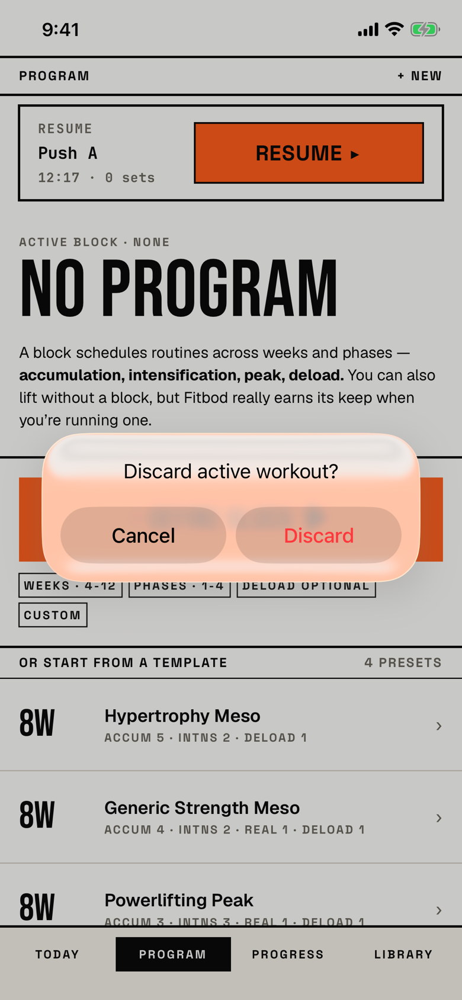

The lifter long-presses Program's resume banner, picks Discard and confirms that the workout in progress is deleted.

## Trigger

| From | Tap | Kind |
|---|---|---|
| [program](program.md) | Long-press the resume banner, then Discard in its context menu | alert |

Nothing on the banner shows that a long-press holds Discard (`fitbod/Sessions/ResumeWorkoutBanner.swift:107`).
The tour launched the demo seed, opened Program and long-pressed the banner's time line.

## Buttons

| Button | Role | Does | Closes with |
|---|---|---|---|
| Cancel | cancel | Closes the alert; the workout stays | cancel |
| Discard | destructive | Clears the rest timer and deletes the workout with its sets | verb |

## Copy check

- The alert has no message, so it does not say how many logged sets are lost, which `docs/design-system/interaction.md` asks a confirmation to name.
- Today's slab asks the same job as "Discard workout?" with the set count; this one says "active workout".

## Screenshot

| State | How to reach it | Screenshot |
|---|---|---|
| Main | Demo seed, Program, long-press the banner, Discard | [light](img/17e-default-light-dialog-discard-active.png) |

The Pro Max at default text changes only size: [Pro Max](img/17promax-default-light-dialog-discard-active.png).
The alert's glass picks up the orange button behind it, so the whole card turns salmon and Cancel sits on orange.
The tour reaches this alert only in a walk, so it has no dark or AX3 capture.

VoiceOver order, from the tree:

1. "Discard active workout?"
2. "Cancel", button
3. "Discard", button

The buttons are 140 by 48 pt, and nothing is unlabelled.

## Findings

- Minor: [D-56](../audit.md#d-56), [D-57](../audit.md#d-57).
- Polish: [D-221](../audit.md#d-221).
