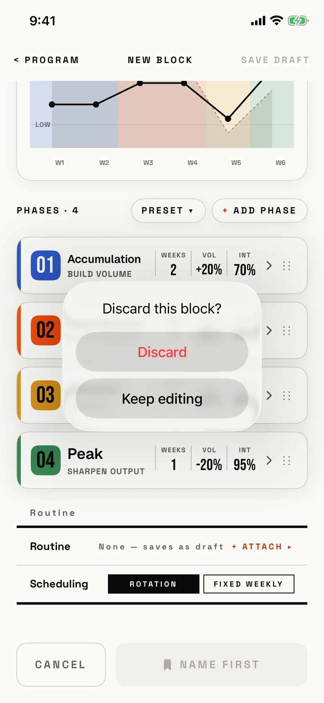

The lifter leaves New Block with unsaved changes and confirms that the new block is thrown away.

## Trigger

| From | Tap | Kind |
|---|---|---|
| [new-block](new-block.md) | CANCEL or ‹ PROGRAM, with unsaved changes | dialog |

Without unsaved changes, both controls close New Block at once (`fitbod/Periodization/BlockBuilderView.swift:230`).
In Edit Block the same dialog is titled "Discard changes?" and keeps the saved block (`fitbod/Periodization/BlockBuilderView.swift:239`).
A swipe down cannot close the cover while there are unsaved changes.
The tour tapped CANCEL after adding a Peak phase.

## Buttons

| Button | Role | Does | Closes with |
|---|---|---|---|
| Discard | destructive | Closes New Block and drops the draft | verb |
| Keep editing | default | Closes the dialog | verb |

Keep editing has no role, because iOS 26 hides a cancel-role button; a tap outside also closes the dialog.

## Copy check

- The dialog has no message, so it does not say what is lost, such as the edited phases.
- "Discard" and "Keep editing" match the session editor's "Discard changes?" dialog.

## Screenshot

| State | How to reach it | Screenshot |
|---|---|---|
| New Block | Edit a phase, CANCEL | [light](img/17e-default-light-dialog-discard-block.png) |
| Dark | Same, in dark mode | [dark](img/17e-default-dark-dialog-discard-block.png) |
| AX3 | Same, at AX3; the title wraps to two lines and the dialog is 354 pt wide | [AX3](img/17e-ax3-light-dialog-discard-block.png) |
| Edit Block, "Discard changes?" | Not captured: the tour does not edit a saved block and cancel | - |
| Pro Max, AX3 | Same, at AX3 on the Pro Max; the title stays on one line | [Pro Max AX3](img/17promax-ax3-light-dialog-discard-block.png) |

Dark mode and the Pro Max at default text change only colour and size: [dark](img/17e-default-dark-dialog-discard-block.png), [Pro Max](img/17promax-default-light-dialog-discard-block.png).

VoiceOver order, from the tree:

1. "Discard this block?"
2. "Discard", button
3. "Keep editing", button

The buttons are 208 by 48 pt, and nothing is unlabelled.

## Findings

- Polish: [D-222](../audit.md#d-222).
