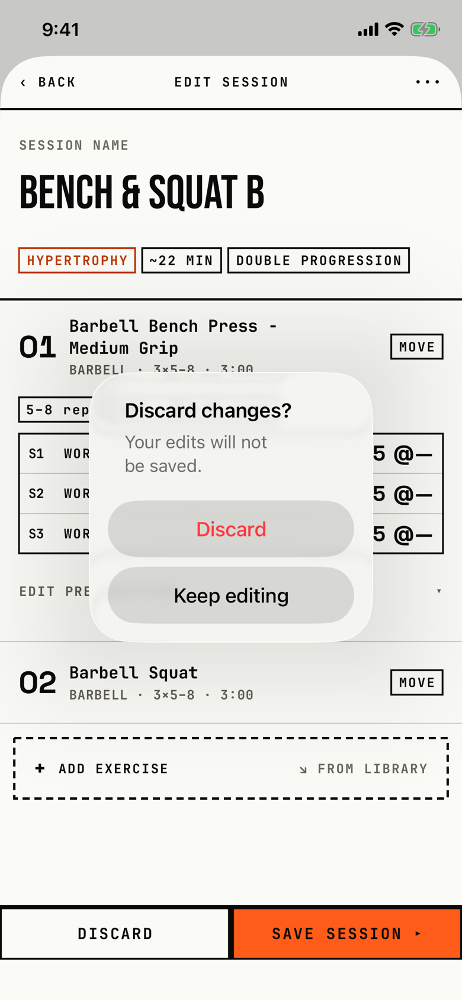

The lifter decides whether to throw away unsaved edits to a session.

## Trigger

In [session-editor](session-editor.md) with unsaved edits, the lifter taps BACK in the header or DISCARD in the bottom bar (`fitbod/Routines/RoutineBuilderView.swift:534`).
With no edits, both close the editor at once.
A swipe down is blocked while there are edits, so it cannot skip the dialog.
The session editor opens from Program and from Today, so the dialog shows on either tab.

## Buttons

| Button | Role | Result |
|---|---|---|
| Discard | destructive, red | Closes the editor and drops the edits. |
| Keep editing | plain | Closes the dialog. |

iOS 26 hides a cancel-role button, so the code uses a plain Keep editing; a tap outside the popover also closes it.
Both buttons are 208 by 48 pt, and 322 by 82.7 pt at AX3.

## Copy check

- Sentence case throughout, which matches the guide.
- The same job in the custom exercise editor asks "Discard Changes?" in Title Case with no message ([dialog-custom-exercise-discard](dialog-custom-exercise-discard.md)).
- The mock-up draws a square BRU card titled "DISCARD 4 CHANGES?" that lists the changes, with KEEP EDITING and a signal DISCARD side by side; the app uses the system popover and does not count or list the edits.

## Screenshot

| State | How to reach it | Screenshot |
|---|---|---|
| Main | Main tour, rename "Bench & Squat" to "Bench & Squat B", BACK | [image](img/17e-default-light-dialog-discard-changes-session.png) |
| AX3 | Main tour at AX3 | [image](img/17e-ax3-light-dialog-discard-changes-session.png) |
| Pro Max, AX3 | Main tour at AX3 on the Pro Max; the title stays on one line | [Pro Max AX3](img/17promax-ax3-light-dialog-discard-changes-session.png) |

On both phones at AX3 the popover grows to the screen width and covers the session name.
Dark mode and the Pro Max at default text change only colour and size: [dark](img/17e-default-dark-dialog-discard-changes-session.png), [Pro Max](img/17promax-default-light-dialog-discard-changes-session.png).

## Findings

<!-- findings are linked after the audit -->
