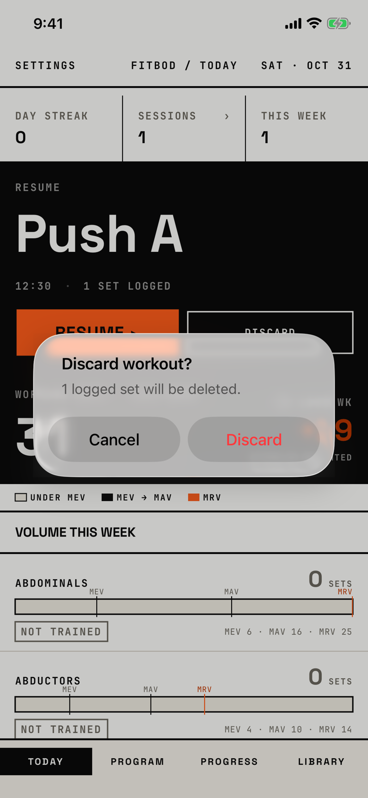

The lifter taps DISCARD on Today's resume slab and confirms that the workout in progress, with its logged sets, is deleted.

## Trigger

| From | Tap | Kind |
|---|---|---|
| [today](today.md) | DISCARD on the black resume slab | alert |

The tour launched the demo seed, which leaves today's Push A in progress with one logged set, and tapped DISCARD.

## Buttons

| Button | Role | Does | Closes with |
|---|---|---|---|
| Cancel | cancel | Closes the alert; the workout stays | cancel |
| Discard | destructive | Clears the rest timer and deletes the workout with its sets | verb |

This is an alert, so iOS 26 shows Cancel on the left and the red Discard on the right.

## Copy check

- The message counts the sets that will be lost, "1 logged set will be deleted.", which names the consequence as `docs/design-system/interaction.md` asks.
- The same job is asked differently elsewhere: Program's banner asks "Discard active workout?" with no message, and the logger asks "Discard workout?" with "No data will be saved." and Keep logging.
- The slab offers Discard even with logged sets, while the logger's menu offers it only with none.

## Screenshot

| State | How to reach it | Screenshot |
|---|---|---|
| Main, one logged set | Demo seed, DISCARD on the slab | [light](img/17e-default-light-dialog-discard-workout-slab.png) |
| Dark | Same, in dark mode | [dark](img/17e-default-dark-dialog-discard-workout-slab.png) |
| No logged sets | Not captured: the message then reads "0 logged sets will be deleted." | - |
| AX3 | Same, at AX3; the title wraps to two lines and the buttons stack with Discard on top | [AX3](img/17e-ax3-light-dialog-discard-workout-slab.png) |
| Pro Max, AX3 | Same, at AX3 on the Pro Max; the title stays on one line and Cancel and Discard stay side by side | [Pro Max AX3](img/17promax-ax3-light-dialog-discard-workout-slab.png) |

iOS 26 draws the alert as a small glass card over the slab, so the slab's RESUME button shows through it in light mode.
Dark mode and the Pro Max at default text change only colour and size: [dark](img/17e-default-dark-dialog-discard-workout-slab.png), [Pro Max](img/17promax-default-light-dialog-discard-workout-slab.png).

VoiceOver order, from the tree:

1. "Discard workout?"
2. "1 logged set will be deleted."
3. "Cancel", button
4. "Discard", button

Both buttons are 140 by 48 pt, and nothing is unlabelled.

## Findings

<!-- findings are linked after the audit -->
