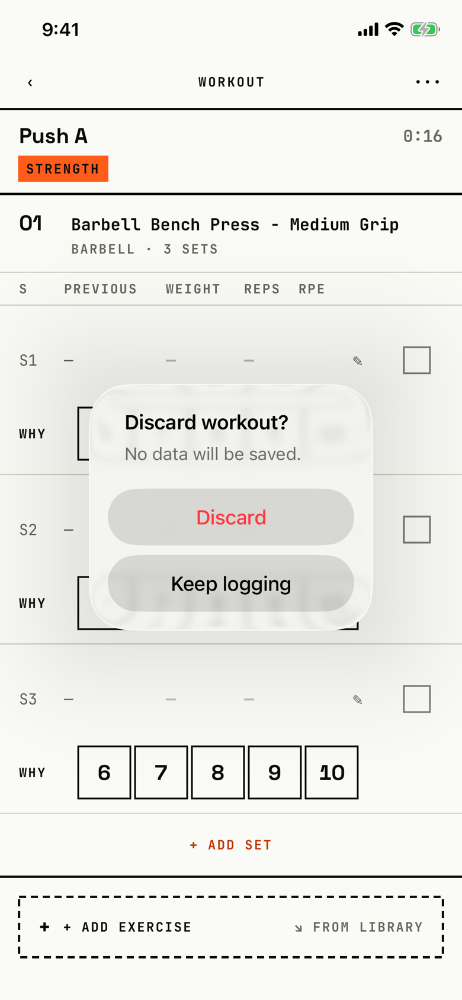

The lifter confirms that a workout with nothing logged is thrown away from inside the logger.

## Trigger

| From | Tap | Kind |
|---|---|---|
| [dialog-workout-menu](dialog-workout-menu.md) | Discard, shown only while no set is logged | dialog |

The tour reached it in walk W15 on a new Push A workout with no logged set.

## Buttons

| Button | Role | Does | Closes with |
|---|---|---|---|
| Discard | destructive | Stops the rest timer, deletes the workout and leaves the logger | verb |
| Keep logging | default | Closes the dialog | verb |

Keep logging has no role, because iOS 26 hides a cancel-role button; a tap outside also closes the dialog.
The code chose a dialog over an alert so that no second, visible Cancel appears beside Keep logging (`fitbod/Sessions/SessionLoggerView.swift:171`).

## Copy check

- "No data will be saved." is true only because the dialog is reachable with nothing logged; it does not name what is deleted.
- Today's slab asks the same question with the same title as an alert, with a set count and a visible Cancel; Program's banner asks "Discard active workout?".
- The verb matches the title.

## Screenshot

| State | How to reach it | Screenshot |
|---|---|---|
| Main | Walk W15: a new workout, ••• then Discard | [light](img/17e-default-light-dialog-discard-workout.png) |

The Pro Max at default text changes only size: [Pro Max](img/17promax-default-light-dialog-discard-workout.png).
The tour reaches this dialog only in a walk, so it has no dark or AX3 capture.

VoiceOver order, from the tree:

1. "Discard workout?"
2. "No data will be saved."
3. "Discard", button
4. "Keep logging", button

The buttons are 208 by 48 pt, and nothing is unlabelled.

## Findings

- Minor: [D-56](../audit.md#d-56).
- Polish: [D-227](../audit.md#d-227).
