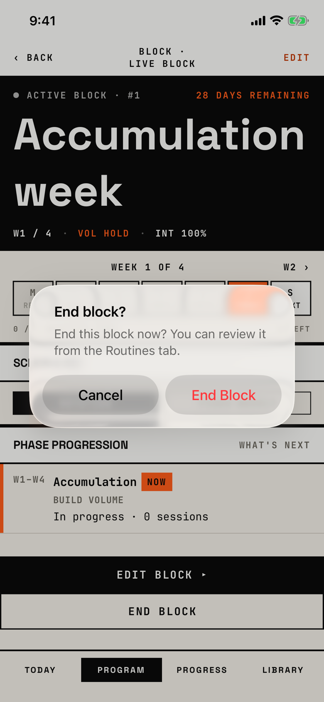

The lifter confirms that the active block ends today.

## Trigger

| From | Tap | Kind |
|---|---|---|
| [block-overview](block-overview.md) | END BLOCK, on the active block | alert |

Block overview opens from Program and from Today, and END BLOCK shows only on the active block.
The tour opened Live Block on the active-block seed and tapped END BLOCK.

## Buttons

| Button | Role | Does | Closes with |
|---|---|---|---|
| Cancel | cancel | Closes the alert | cancel |
| End Block | destructive | Ends the block and freezes its plan for the review; a failed save shows [dialog-couldnt-save](dialog-couldnt-save.md) | verb |

## Copy check

- The message sends the lifter to "the Routines tab", which does not exist; the orchestrator's table holds this, and T34 changes it to the Program tab.
- The message repeats the title's question, "End this block now?".
- The button reads "End Block" in title case under a sentence-case title.
- The message does not say that a review of the block will follow on Today.

## Screenshot

| State | How to reach it | Screenshot |
|---|---|---|
| Main | Active-block seed, Live Block, END BLOCK | [light](img/17e-default-light-dialog-end-block.png) |
| Dark | Same, in dark mode | [dark](img/17e-default-dark-dialog-end-block.png) |
| AX3 | Same, at AX3; on both phones the buttons stack with End Block on top, 96 pt each | [AX3](img/17e-ax3-light-dialog-end-block.png), [Pro Max AX3](img/17promax-ax3-light-dialog-end-block.png) |

Dark mode and the Pro Max at default text change only colour and size: [dark](img/17e-default-dark-dialog-end-block.png), [Pro Max](img/17promax-default-light-dialog-end-block.png).

VoiceOver order, from the tree:

1. "End block?"
2. "End this block now? You can review it from the Routines tab."
3. "Cancel", button
4. "End Block", button

The buttons are 140 by 48 pt, and nothing is unlabelled.

## Findings

<!-- findings are linked after the audit -->
