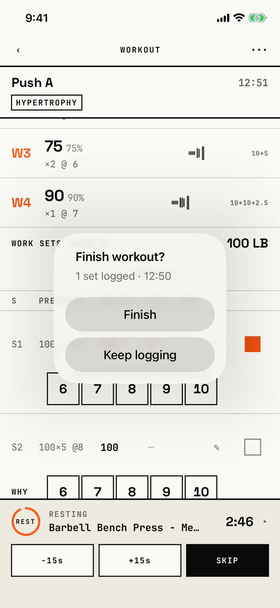

The lifter confirms that the workout is over, or, with nothing logged, throws it away.

## Trigger

| From | Tap | Kind |
|---|---|---|
| [dialog-workout-menu](dialog-workout-menu.md) | Finish | dialog |

The logger has no Finish control of its own; the menu is the only way in, so the inventory's edge from the logger itself is dropped.
The tour logged one set on the demo seed's Push A, then opened ••• and Finish.

## Buttons

| Button | Role | Does | Closes with |
|---|---|---|---|
| Finish | default | Stamps the end time, stops the rest timer and opens the [workout-summary](workout-summary.md) | verb |
| Discard workout | destructive | Shown instead of Finish when no set is logged; deletes the workout at once | verb |
| Keep logging | default | Closes the dialog | verb |

Keep logging has no role on purpose, because iOS 26 hides a cancel-role button (`fitbod/Sessions/SessionLoggerView.swift:164`).
A tap outside also closes the dialog.

## Copy check

- The message counts sets and shows the elapsed time, "1 set logged · 12:50".
- The time is taken when the dialog opens and does not tick, so it already lags the header's 12:51 in the capture.
- With no set logged, the title still asks "Finish workout?" while its only action is "Discard workout", so the question and the answer do not match.

## Screenshot

| State | How to reach it | Screenshot |
|---|---|---|
| Main, one set logged | Demo seed, log a set, ••• then Finish | [light](img/17e-default-light-dialog-finish-workout.png) |
| No set logged | Walk W15: a new workout, ••• then Finish | [light](img/17e-default-light-dialog-finish-workout--zero-sets.png) |
| Dark | Main state, in dark mode | [dark](img/17e-default-dark-dialog-finish-workout.png) |
| AX3 | Main state at AX3; the message wraps the elapsed time to its own line | [AX3](img/17e-ax3-light-dialog-finish-workout.png) |
| Pro Max, AX3 | Main state at AX3 on the Pro Max; the message fits on one line, so the elapsed time stays beside the set count, and the dialog sits below the Push A header, which stays visible, where on the 17e it covers the header | [Pro Max AX3](img/17promax-ax3-light-dialog-finish-workout.png) |

Dark mode and the Pro Max at default text change only colour and size: [dark](img/17e-default-dark-dialog-finish-workout.png), [Pro Max](img/17promax-default-light-dialog-finish-workout.png), [Pro Max, no set logged](img/17promax-default-light-dialog-finish-workout--zero-sets.png).

VoiceOver order, from the tree:

1. "Finish workout?"
2. "1 set logged · 12:50"
3. "Finish", button
4. "Keep logging", button

The buttons are 208 by 48 pt, and nothing is unlabelled.

## Findings

- Polish: [D-223](../audit.md#d-223), [D-224](../audit.md#d-224).
