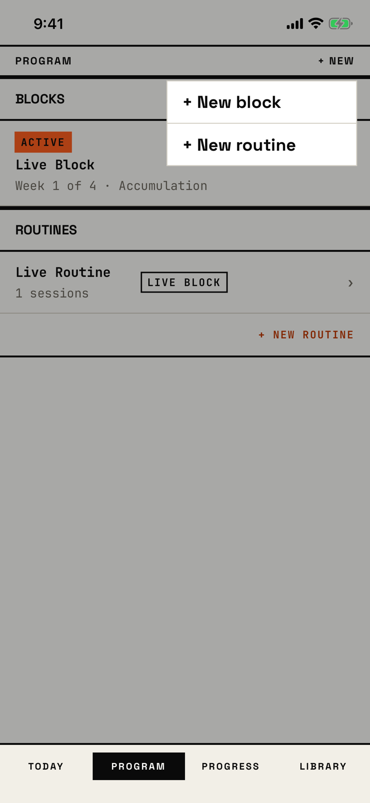

The lifter taps + NEW on Program and picks whether to build a block or a routine.

## Trigger

| From | Tap | Kind |
|---|---|---|
| [program](program.md) | + NEW in the header | dialog |

This is the app's own square menu, `BRUActionPopover`, drawn over a 34% ink scrim, not a system dialog.
It has no title; the id's title is the button that opens it.
The tour opened it on the active-block seed.

## Buttons

| Button | Role | Does | Closes with |
|---|---|---|---|
| + New block | default | Opens [start-choice](start-choice.md) | verb |
| + New routine | default | Pushes [new-routine](new-routine.md) | verb |
| The scrim | - | A tap anywhere outside the menu closes it | cancel |

There is no Cancel button; a tap on the scrim is the only way to close the menu without choosing.

## Copy check

- The items say block and routine, the app's words.
- The items are in sentence case with a typed "+", while the header button reads "+ NEW" and the link on the page reads "+ NEW ROUTINE" in capitals.

## Screenshot

| State | How to reach it | Screenshot |
|---|---|---|
| Main | Active-block seed, Program, + NEW | [light](img/17e-default-light-dialog-program-new.png) |
| Dark | Same, in dark mode; the menu turns ink with paper text, and the ink scrim lightens the dark page to grey instead of dimming it | [dark](img/17e-default-dark-dialog-program-new.png) |
| AX3 | Same, at AX3; the menu sits under the header and spans the 17e, 360 pt wide, but stops at 400 pt on the Pro Max, leaving a 26 pt strip on the left where slivers of the BLOCKS header and the ACTIVE chip show | [AX3](img/17e-ax3-light-dialog-program-new.png), [Pro Max AX3](img/17promax-ax3-light-dialog-program-new.png) |

The Pro Max at default text changes only size: [Pro Max](img/17promax-default-light-dialog-program-new.png).

### Compared with the mock-up

| In the mock-up | In the app | Difference |
|---|---|---|
| + NEW in signal orange | + NEW in ink | The header action lost its accent |
| Menu sits over the black active-block hero | Menu sits over the BLOCKS list | The page behind changed; the menu matches |
| Hard offset shadow under the menu | No offset shadow; a scrim dims the page instead | The menu's edge relies on the scrim |

VoiceOver order, from the tree:

1. The Program page behind, from "Blocks" to "+ NEW ROUTINE"
2. "PROGRAM"
3. "+ NEW", button
4. "+ New block", button
5. "+ New routine", button

The menu is not modal: VoiceOver reads the whole page behind it first and can still activate it.
The scrim has no accessibility element, so VoiceOver cannot close the menu without choosing; the system dialogs expose a "dismiss popup" element for this.
The items are 200 by 44 pt.

## Findings

<!-- findings are linked after the audit -->
