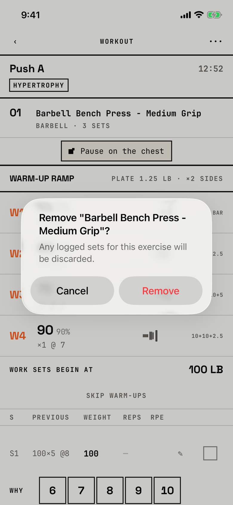

The lifter confirms that an exercise, with any sets already logged for it, leaves the workout in progress.

## Trigger

| From | Tap | Kind |
|---|---|---|
| [logger](logger.md) | Long-press an exercise's header, then Remove from Session | alert |

The title quotes the exercise's name, as in `Remove "Barbell Bench Press - Medium Grip"?`.
The context menu that leads here says "Remove from Session" (`fitbod/Sessions/SessionExerciseCard.swift:147`), which T34 renames to "Remove from workout".
The tour opened it on the demo seed's Push A.

## Buttons

| Button | Role | Does | Closes with |
|---|---|---|---|
| Cancel | cancel | Closes the alert | cancel |
| Remove | destructive | Deletes the exercise and its sets from this workout | verb |

This is an alert, so iOS 26 shows Cancel on the left and the red Remove on the right; at AX3 the buttons stack with Remove on top.

## Copy check

- The message names the consequence.
- The other two logger questions, Finish and Discard, are dialogs with "Keep logging", while this one is an alert with "Cancel".
- The session it came from does not change, and the alert does not say so.

## Screenshot

| State | How to reach it | Screenshot |
|---|---|---|
| Main | Demo seed, long-press the exercise header, Remove from Session | [light](img/17e-default-light-dialog-remove-exercise.png) |
| Dark | Same, in dark mode | [dark](img/17e-default-dark-dialog-remove-exercise.png) |
| AX3 | Same, at AX3; the title wraps to four lines and the buttons stack, 96 pt each | [AX3](img/17e-ax3-light-dialog-remove-exercise.png) |
| Pro Max, AX3 | Same, at AX3 on the Pro Max; the title wraps to three lines instead of four, Cancel and Remove stay side by side instead of stacking, and the Push A header stays visible above the alert | [Pro Max AX3](img/17promax-ax3-light-dialog-remove-exercise.png) |

Dark mode and the Pro Max at default text change only colour and size: [dark](img/17e-default-dark-dialog-remove-exercise.png), [Pro Max](img/17promax-default-light-dialog-remove-exercise.png).

VoiceOver order, from the tree:

1. `Remove "Barbell Bench Press - Medium Grip"?`
2. "Any logged sets for this exercise will be discarded."
3. "Cancel", button
4. "Remove", button

The buttons are 140 by 48 pt, and nothing is unlabelled.

## Findings

- Minor: [D-34](../audit.md#d-34).
- Polish: [D-227](../audit.md#d-227).
