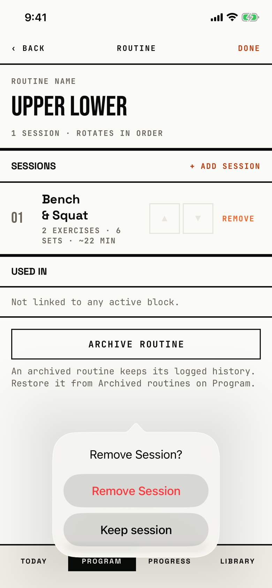

The lifter confirms taking a session out of the routine they are editing.

## Trigger

On [routine-editor](routine-editor.md), the lifter taps Edit and then REMOVE on a session row.
The dialog is a system confirmation dialog drawn as a popover.
Its arrow points at the middle of the screen, not at the REMOVE the lifter tapped, because the dialog is attached to the whole screen (`fitbod/Periodization/SplitDetailView.swift:185`).

## Buttons

| Button | Role | Result |
|---|---|---|
| Remove Session | destructive, red | Deletes the slot and saves (`fitbod/Periodization/SplitDetailView.swift:503`). The save fails every time, and [dialog-couldnt-save](dialog-couldnt-save.md) follows; see the orchestrator's blocker row on Remove Session. |
| Keep session | plain | Closes the dialog and keeps the session. |

There is no cancel-role button.
The code adds the plain Keep session button because iOS 26 hides a cancel-role button; a tap outside the popover ("dismiss popup" in the tree) also closes it.
Both buttons are 208 by 48 pt at default text and 322 by 82.7 pt at AX3.

## Copy check

- The title and the destructive button use Title Case ("Remove Session?", "Remove Session"), while the plain button uses sentence case ("Keep session").
- The dialog does not name the session it removes; the long-name state shows three sessions and the dialog cannot be told apart for any of them.
- There is no message, so it does not say that the session itself stays in the library of sessions and only leaves this routine.
- VoiceOver reads the title, then Remove Session, then Keep session.

## Screenshot

| State | How to reach it | Screenshot |
|---|---|---|
| Main | Main tour, "Bench & Squat" routine, Edit, REMOVE | [image](img/17e-default-light-dialog-remove-session.png) |
| long-name | W12, Upper Lower with three sessions, Edit, REMOVE on Upper A | [image](img/17e-default-light-dialog-remove-session--long-name.png) |
| AX3 | Main tour at AX3 | [image](img/17e-ax3-light-dialog-remove-session.png) |
| Pro Max, AX3 | Main tour at AX3 on the Pro Max; the title stays on one line and the popover sits lower, so the first session row stays visible above it | [Pro Max AX3](img/17promax-ax3-light-dialog-remove-session.png) |
| Pro Max, long-name | Same as long-name above, on the Pro Max; the popover sits lower and leaves the Used in row and most of ARCHIVE ROUTINE visible, where on the 17e it covers ARCHIVE ROUTINE and half the Used in row | [Pro Max](img/17promax-default-light-dialog-remove-session--long-name.png) |

On the 17e at AX3 the title wraps to two lines and the popover covers the sessions list.
Dark mode and the Pro Max at default text change only colour and size: [dark](img/17e-default-dark-dialog-remove-session.png), [Pro Max](img/17promax-default-light-dialog-remove-session.png).

## Findings

- Blocker: [D-01](../audit.md#d-01).
- Polish: [D-214](../audit.md#d-214), [D-228](../audit.md#d-228), [D-229](../audit.md#d-229).
