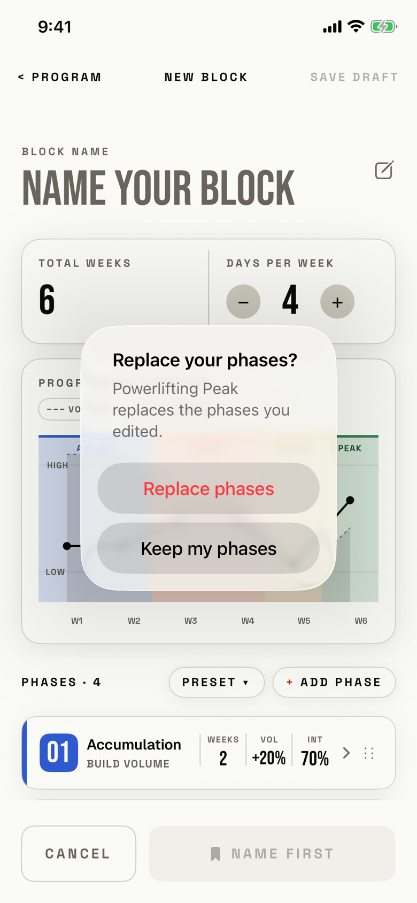

The lifter picks a preset after editing the phases by hand, and confirms that the preset's phases replace the edited ones.

## Trigger

| From | Tap | Kind |
|---|---|---|
| [new-block-template](new-block-template.md) | A preset, when the phases on New Block were edited | dialog |

The dialog waits until the preset sheet has closed and then shows over New Block (`fitbod/Periodization/BlockBuilderView.swift:291`).
A preset picked while the phases are untouched applies at once without asking.
The tour added a Peak phase, then picked POWERLIFTING PEAK under PRESET.
Edit Block uses the same view, so the dialog can also show there, and New Block also opens from Today.

## Buttons

| Button | Role | Does | Closes with |
|---|---|---|---|
| Replace phases | destructive | Applies the preset: its phases and its name | verb |
| Keep my phases | default | Keeps the edited phases and drops the whole pick, name included | verb |

Keep my phases has no role, because iOS 26 hides a cancel-role button; a tap outside also closes the dialog.

## Copy check

- The message names the preset and the consequence.
- The button verbs repeat the title's words.
- "Keep my phases" also drops the preset's name, which the dialog does not say.

## Screenshot

| State | How to reach it | Screenshot |
|---|---|---|
| Main | New Block, + ADD PHASE Peak, PRESET, POWERLIFTING PEAK | [light](img/17e-default-light-dialog-replace-phases.png) |
| Dark | Same, in dark mode | [dark](img/17e-default-dark-dialog-replace-phases.png) |
| AX3 | Same, at AX3; on both phones the dialog spans the screen less its margins, 354 pt wide on the 17e and about 404 pt on the Pro Max, and covers the page from the title to the action bar | [AX3](img/17e-ax3-light-dialog-replace-phases.png), [Pro Max AX3](img/17promax-ax3-light-dialog-replace-phases.png) |

Dark mode and the Pro Max at default text change only colour and size: [dark](img/17e-default-dark-dialog-replace-phases.png), [Pro Max](img/17promax-default-light-dialog-replace-phases.png).

VoiceOver order, from the tree:

1. "Replace your phases?"
2. "Powerlifting Peak replaces the phases you edited."
3. "Replace phases", button
4. "Keep my phases", button

The buttons are 208 by 48 pt, and nothing is unlabelled.

## Findings

The audit has no row for this file.
