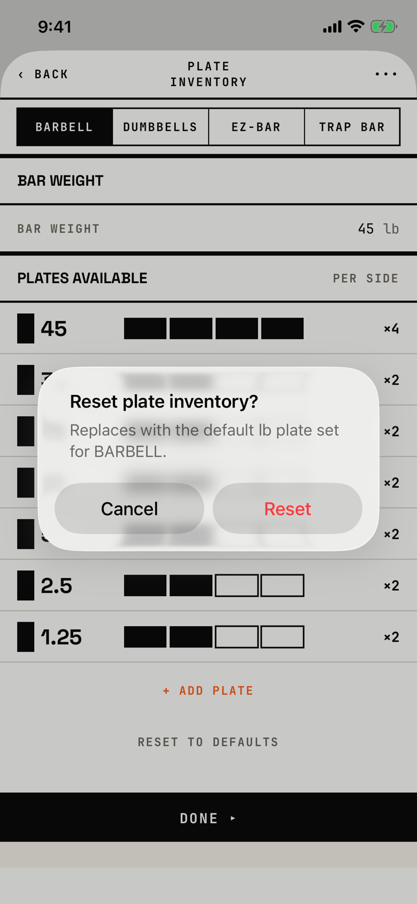

The lifter confirms putting the selected bar's plates and bar weight back to the defaults.

## Trigger

On [plate-inventory](plate-inventory.md), the lifter taps RESET TO DEFAULTS under the plate list (`fitbod/Settings/PlateInventoryEditor.swift:319`).
It resets only the equipment tab that is selected.

## Buttons

| Button | Role | Result |
|---|---|---|
| Cancel | cancel | Closes the alert. |
| Reset | destructive, red | Replaces the plates and bar weight for that equipment and saves; a failed save is ignored without a message (`fitbod/Settings/PlateInventoryEditor.swift:129`). |

This is an alert, so Cancel stays visible.
Both buttons are 140 by 48 pt, and 157 by 96 pt at AX3.

## Copy check

- The message is a fragment with no subject ("Replaces with...").
- It drops the unit abbreviation "lb" and the tab name in capitals, "BARBELL", into the middle of a sentence.
- It does not say that the bar weight resets too.

## Screenshot

| State | How to reach it | Screenshot |
|---|---|---|
| Main | Main tour, Settings, Plate Inventory, RESET TO DEFAULTS | [image](img/17e-default-light-dialog-reset-plate-inventory.png) |
| AX3 | Main tour at AX3, the same on both phones | [image](img/17e-ax3-light-dialog-reset-plate-inventory.png), [Pro Max AX3](img/17promax-ax3-light-dialog-reset-plate-inventory.png) |

On both phones at AX3 the title and message wrap and the buttons stay side by side.
Dark mode and the Pro Max at default text change only colour and size: [dark](img/17e-default-dark-dialog-reset-plate-inventory.png), [Pro Max](img/17promax-default-light-dialog-reset-plate-inventory.png).

## Findings

<!-- findings are linked after the audit -->
