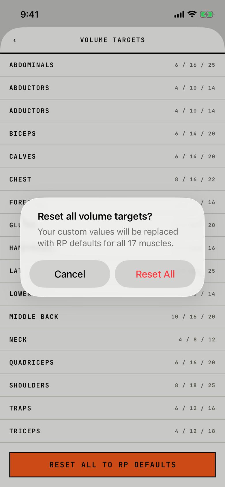

The lifter confirms putting every muscle's volume targets back to the RP defaults.

## Trigger

On [volume-targets](volume-targets.md), the lifter taps RESET ALL TO RP DEFAULTS at the bottom of the list (`fitbod/Settings/MuscleVolumeTargetEditor.swift:64`).

## Buttons

| Button | Role | Result |
|---|---|---|
| Cancel | cancel | Closes the alert. |
| Reset All | destructive, red | Writes the RP landmarks to all 17 muscles and saves; a failed save is ignored without a message (`fitbod/Settings/MuscleVolumeTargetEditor.swift:165`). |

This is an alert, so Cancel stays visible.
Both buttons are 140 by 48 pt side by side; at AX3 they stack, Reset All on top and Cancel below, each 322 by 96 pt.

## Copy check

- The message names the consequence and the scope, which matches the guide.
- "Reset All" is in Title Case while the title is in sentence case.
- "RP" is not spelled out anywhere on the way here.

## Screenshot

| State | How to reach it | Screenshot |
|---|---|---|
| Main | Main tour, Settings, Volume Targets, RESET ALL TO RP DEFAULTS | [image](img/17e-default-light-dialog-reset-volume-targets.png) |
| AX3 | Main tour at AX3, the same on both phones | [image](img/17e-ax3-light-dialog-reset-volume-targets.png), [Pro Max AX3](img/17promax-ax3-light-dialog-reset-volume-targets.png) |

On both phones at AX3 the alert fills most of the screen and its buttons stack, with the destructive button first.
Dark mode and the Pro Max at default text change only colour and size: [dark](img/17e-default-dark-dialog-reset-volume-targets.png), [Pro Max](img/17promax-default-light-dialog-reset-volume-targets.png).

## Findings

<!-- findings are linked after the audit -->
