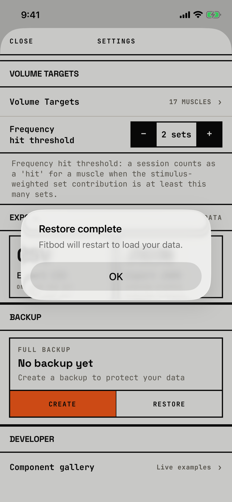

The lifter learns the restore worked and that the app must start again.

## Trigger

After Restore in [dialog-restore-confirm](dialog-restore-confirm.md) succeeds.

## Buttons

| Button | Role | Result |
|---|---|---|
| OK | default | Ends the app's process (`fitbod/Backup/BackupRestorer.swift:282`). iOS does not reopen it, so the lifter lands on the Home Screen and must open Fitbod again. |

OK is the only button and the alert cannot be dismissed any other way.
It is 288 by 48 pt.

## Copy check

- "Fitbod will restart" promises a restart, but OK only closes the app, which looks like a crash.
- OK is the only way on, so the lifter cannot stay in the app after the restore.

## Screenshot

| State | How to reach it | Screenshot |
|---|---|---|
| Main | W02, RESTORE, pick the walk's own backup, Restore | [image](img/17e-default-light-dialog-restore-complete.png) |

The Pro Max at default text changes only size: [Pro Max](img/17promax-default-light-dialog-restore-complete.png).
Walk-only dialog, so no dark or AX3 capture exists.

## Findings

- Minor: [D-60](../audit.md#d-60).
