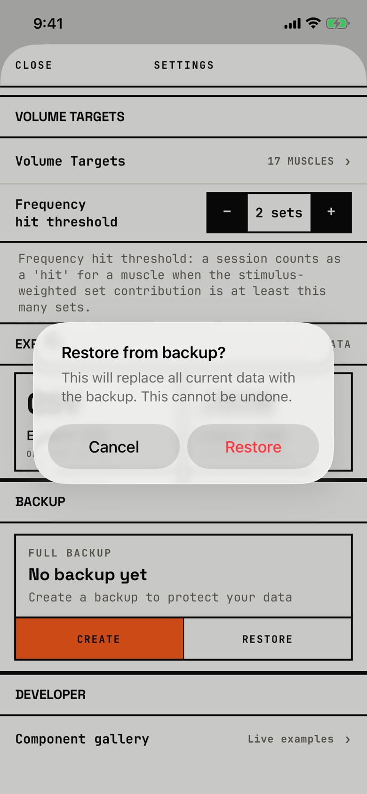

The lifter confirms replacing everything in the app with a backup file.

## Trigger

In [settings](settings.md), the lifter taps RESTORE and picks a backup in [file-importer](file-importer.md).
The app checks the file first; a good file shows this alert, and a bad one shows [dialog-restore-error](dialog-restore-error.md) (`fitbod/Settings/SettingsView.swift:470`).

## Buttons

| Button | Role | Result |
|---|---|---|
| Cancel | cancel | Closes the alert; nothing changes. |
| Restore | destructive, red | Replaces the store with the backup, then shows [dialog-restore-complete](dialog-restore-complete.md), or [dialog-restore-error](dialog-restore-error.md) on failure. |

This is an alert, so Cancel stays visible.
Both buttons are 140 by 48 pt.

## Copy check

- Sentence case, and the message names the consequence and that it cannot be undone, which matches the guide.
- It does not say which backup was picked or when it was made, although the check has already read the file.

## Screenshot

| State | How to reach it | Screenshot |
|---|---|---|
| Main | W02, Settings, CREATE a backup and save it to Files, RESTORE, pick it | [image](img/17e-default-light-dialog-restore-confirm.png) |

The Pro Max at default text changes only size: [Pro Max](img/17promax-default-light-dialog-restore-confirm.png).
Walk-only dialog, so no dark or AX3 capture exists.

## Findings

The audit has no row for this file.
