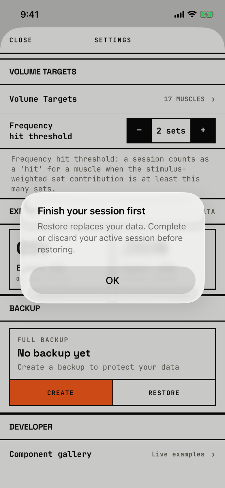

The lifter learns why a backup cannot be restored.

## Trigger

After the lifter picks a file in [file-importer](file-importer.md), the check fails, or the restore itself fails after Restore in [dialog-restore-confirm](dialog-restore-confirm.md) (`fitbod/Settings/SettingsView.swift:496`).
The title and message depend on the error (`fitbod/Settings/SettingsView.swift:519`):

| Title | Message |
|---|---|
| Couldn't read backup | Make sure the file is a `.fitbodbackup` file from Fitbod. |
| Backup is damaged | This backup file's contents don't match its checksum. Try a different backup. |
| Backup version not supported | This backup is from a different version of Fitbod. Restore not supported. |
| Finish your session first | Restore replaces your data. Complete or discard your active session before restoring. |
| Backup contains unsafe entries | This backup includes file paths that can't be safely restored. |
| Backup too large | This backup exceeds the safe restore limit. |

## Buttons

| Button | Role | Result |
|---|---|---|
| OK | default | Closes the alert; nothing changes. |

OK is 288 by 48 pt.

## Copy check

- The captured title and message call the workout in progress a session; this and the typed backticks in the unreadable-file message are orchestrator rows.
- "Backup is damaged" talks about a checksum, a developer word.
- "Restore not supported." is a fragment.
- None of the errors offers a next step inside the alert, such as going to the workout in progress.
- The backup card behind the alert says "No backup yet" although the walk had just made one; that is an orchestrator row on [settings](settings.md).

## Screenshot

| State | How to reach it | Screenshot |
|---|---|---|
| Finish your session first | W04, workout in progress, Settings, CREATE and save a backup, RESTORE, pick it | [image](img/17e-default-light-dialog-restore-error.png) |
| The other five errors | not captured: every backup the tour can make is a good one | - |

The Pro Max at default text changes only size: [Pro Max](img/17promax-default-light-dialog-restore-error.png).
Walk-only dialog, so no dark or AX3 capture exists.

## Findings

- Minor: [D-146](../audit.md#d-146).
- Polish: [D-231](../audit.md#d-231), [D-232](../audit.md#d-232), [D-233](../audit.md#d-233).
