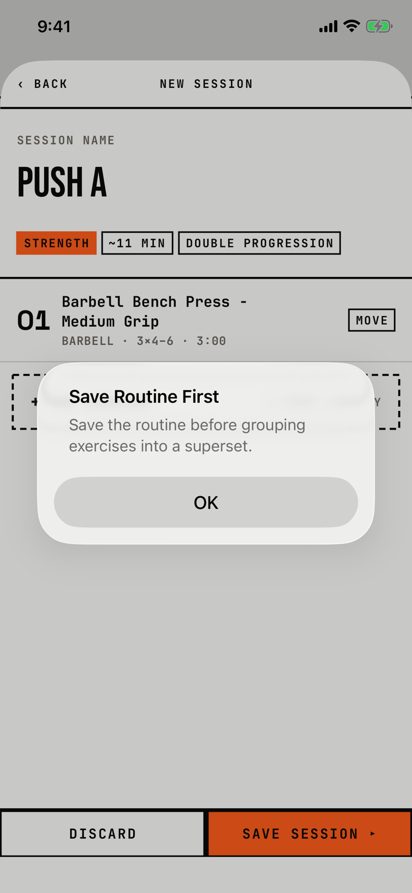

The lifter learns that a new session must be saved before its exercises can form a superset.

## Trigger

In [session-editor](session-editor.md) while creating a new session (header "New session"), the lifter long-presses an exercise card and picks "Make superset" or "Move to superset…" (`fitbod/Routines/RoutineBuilderView.swift:630`).
In an existing session the same items open the superset sheet instead.
Captured in walk W15, on a fresh store.

## Buttons

| Button | Role | Result |
|---|---|---|
| OK | cancel | Closes the alert; nothing is saved and no superset is made. |

OK is 288 by 48 pt.

## Copy check

- The title and message say "routine", but the thing to save is the session being built; the routine is a different object in the app.
- The title is in Title Case, while most alerts use sentence case.
- The alert offers only OK, not a way to save and continue, so the lifter must find SAVE SESSION, reopen the session and long-press again.

## Screenshot

| State | How to reach it | Screenshot |
|---|---|---|
| Main | W15, new session "Push A" with bench press, long-press, Make superset | [image](img/17e-default-light-dialog-save-routine-first.png) |

The Pro Max at default text changes only size: [Pro Max](img/17promax-default-light-dialog-save-routine-first.png).
Walk-only dialog, so no dark or AX3 capture exists.

## Findings

<!-- findings are linked after the audit -->
