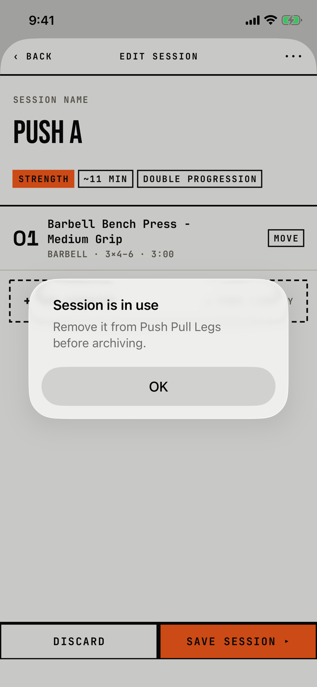

The lifter learns that a session still in a routine cannot be archived.

## Trigger

In [session-editor](session-editor.md), the lifter taps ••• and Archive session in [dialog-session-menu](dialog-session-menu.md) while one or more routines hold the session (`fitbod/Routines/RoutineBuilderView.swift:600`).
The message lists every such routine by name, sorted, with "(archived)" after an archived one.

## Buttons

| Button | Role | Result |
|---|---|---|
| OK | cancel | Closes the alert; the session stays. |

OK is 288 by 48 pt.

## Copy check

- Sentence case, and it names the routine, which helps.
- The fix it asks for, Remove Session on the routine screen, always fails today (see the orchestrator's blocker row), so a session that was ever in a routine can never be archived.
- The alert has no way to go to the routine; the lifter must leave the editor, find the routine on Program, tap Edit and REMOVE.
- For an archived routine, the lifter must first restore the routine to remove the session, which the copy does not say.

## Screenshot

| State | How to reach it | Screenshot |
|---|---|---|
| Main | W15, Push A saved into Push Pull Legs, Edit, More, Archive session | [image](img/17e-default-light-dialog-session-in-use.png) |

The Pro Max at default text changes only size: [Pro Max](img/17promax-default-light-dialog-session-in-use.png).
Walk-only dialog, so no dark or AX3 capture exists.

## Findings

<!-- findings are linked after the audit -->
