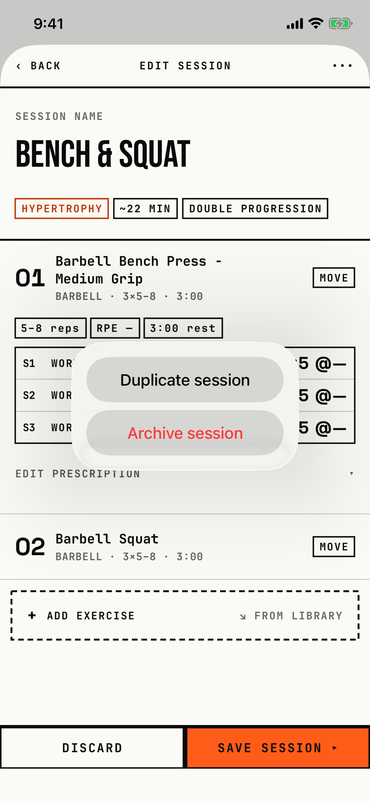

The lifter picks a whole-session action from the editor's more menu.

## Trigger

In [session-editor](session-editor.md) for a saved session, the lifter taps ••• ("More") in the header.
A new session has no ••• button.
The title "Session" is set to hidden, so the menu shows only its two actions.

## Buttons

| Button | Role | Result |
|---|---|---|
| Duplicate session | plain | Copies the saved session, saves, and closes the editor (`fitbod/Routines/RoutineBuilderView.swift:584`). Unsaved edits in the editor are not copied and are dropped without the discard dialog. |
| Archive session | destructive, red | Opens [dialog-archive-session](dialog-archive-session.md), or [dialog-session-in-use](dialog-session-in-use.md) when a routine still holds the session. |

The code also has a Cancel button with the cancel role, which iOS 26 hides.
The only way out is a tap outside the popover ("dismiss popup" in the tree).
Both buttons are 208 by 48 pt; at AX3, Duplicate session wraps to two lines in a 130.7 pt button.

## Copy check

- Sentence case, which matches the guide.
- The menu is a system confirmation dialog, while the design system names `BRUActionPopover` as the replacement for confirmation-dialog menus (as used by Program's New menu).
- Duplicate session gives no hint of where the copy goes or that the editor will close.

## Screenshot

| State | How to reach it | Screenshot |
|---|---|---|
| Main | Main tour, "Bench & Squat" session editor, More | [image](img/17e-default-light-dialog-session-menu.png) |
| AX3 | Main tour at AX3 | [image](img/17e-ax3-light-dialog-session-menu.png) |
| Pro Max, AX3 | Main tour at AX3 on the Pro Max; Duplicate session stays on one line instead of wrapping to two | [Pro Max AX3](img/17promax-ax3-light-dialog-session-menu.png) |

On both phones at AX3 the session name stays visible above the popover, which covers the first exercise.
On the 17e it also covers all three chips, while on the Pro Max HYPERTROPHY and ~22 MIN stay visible and only DOUBLE PROGRESSION is covered.
Dark mode and the Pro Max at default text change only colour and size: [dark](img/17e-default-dark-dialog-session-menu.png), [Pro Max](img/17promax-default-light-dialog-session-menu.png).

## Findings

- Major: [D-09](../audit.md#d-09).
- Minor: [D-63](../audit.md#d-63).
- Polish: [D-234](../audit.md#d-234).
