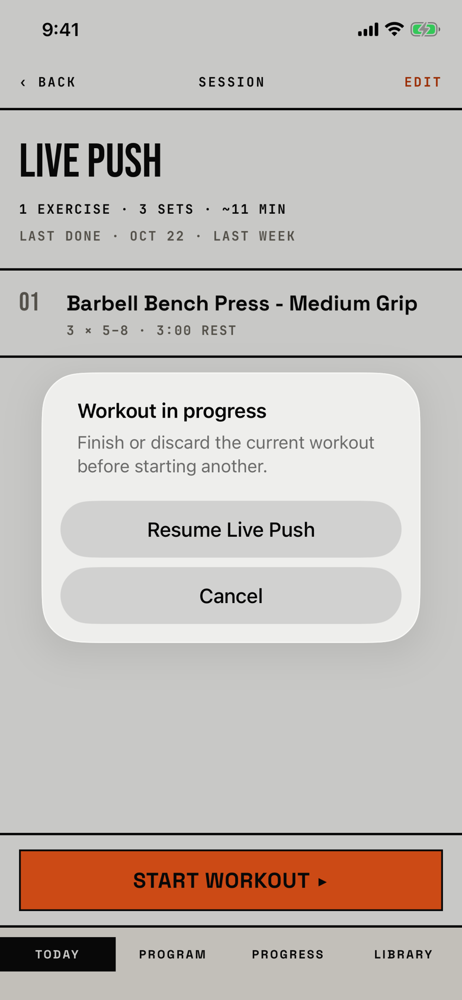

The lifter taps Start workout on a session while another workout is still running, and the app offers to resume that workout instead.

## Trigger

| From | Tap | Kind |
|---|---|---|
| [session-template-detail](session-template-detail.md) | Start workout ▸, while a workout is in progress | alert |

The resume button names the running workout, so it reads "Resume" plus that workout's session name.
Today has an identical alert (`fitbod/Views/TodayView.swift:340`), but Today hides its start controls while a workout is in progress (`fitbod/Views/TodayView.swift:144`), so no lifter can reach that copy.
The tour started Live Push, went back from the logger and tapped Start workout ▸ again (walk W09 launch, `testW03cWorkoutInProgress`).

## Buttons

| Button | Role | Does | Closes with |
|---|---|---|---|
| Resume Live Push | default | Opens the [logger](logger.md) on the running workout | verb |
| Cancel | cancel | Closes the alert and stays on the session | cancel |

This is an alert, so iOS 26 shows its Cancel button.

## Copy check

- The title and both buttons use the app's words: workout for the logged one, and the session's name on the resume button.
- The message asks the lifter to "finish or discard the current workout", but the alert offers neither; Resume is the only way forward.
- The title has no question mark, because it states a fact rather than asking.

## Screenshot

| State | How to reach it | Screenshot |
|---|---|---|
| Main | Start a workout, go back, tap Start workout ▸ again | [light](img/17e-default-light-dialog-workout-in-progress.png) |

The Pro Max at default text changes only size: [Pro Max](img/17promax-default-light-dialog-workout-in-progress.png).
The tour reaches this alert only in a walk, so it has no dark or AX3 capture.

VoiceOver order, from the tree:

1. "Workout in progress"
2. "Finish or discard the current workout before starting another."
3. "Resume Live Push", button
4. "Cancel", button

Both buttons are 48 pt tall and 288 pt wide, and nothing is unlabelled.

## Findings

<!-- findings are linked after the audit -->
