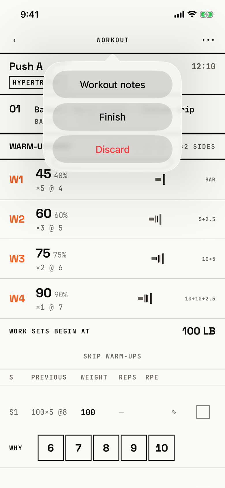

The lifter opens the logger's ••• menu to add workout notes, finish the workout, or discard it.

## Trigger

| From | Tap | Kind |
|---|---|---|
| [logger](logger.md) | ••• (VoiceOver: "More") in the header | dialog |

The dialog's title, "Workout", is hidden, so the menu shows only its buttons.
The tour opened it on the demo seed's Push A before any set was logged.

## Buttons

| Button | Role | Does | Closes with |
|---|---|---|---|
| Workout notes | default | Opens [workout-notes](workout-notes.md) | verb |
| Finish | default | Opens [dialog-finish-workout](dialog-finish-workout.md) | verb |
| Discard | destructive | Opens [dialog-discard-workout](dialog-discard-workout.md); shown only while no set is logged | verb |
| Cancel | cancel | Hidden by iOS 26; a tap outside the menu closes it | cancel |

The code adds a Cancel button with the cancel role (`fitbod/Sessions/SessionLoggerView.swift:266`), which iOS 26 hides.
A tap outside the popover closes it, and VoiceOver reaches a "dismiss popup" element for the same job.

## Copy check

- The labels use the app's words.
- Discard disappears once a set is logged (`fitbod/Sessions/SessionLoggerView.swift:261`), so the logger then has no way to throw the workout away, while Today's slab and Program's banner still offer it.
- Finish opens a second dialog that asks again, so finishing takes three taps from the header.

## Screenshot

| State | How to reach it | Screenshot |
|---|---|---|
| Main, no set logged | Demo seed, resume, ••• | [light](img/17e-default-light-dialog-workout-menu.png) |
| Dark | Same, in dark mode | [dark](img/17e-default-dark-dialog-workout-menu.png) |
| AX3 | Same, at AX3; on both phones the popover spans the screen less its margins, 354 pt on the 17e and about 404 pt on the Pro Max, and each button grows to 83 pt | [AX3](img/17e-ax3-light-dialog-workout-menu.png), [Pro Max AX3](img/17promax-ax3-light-dialog-workout-menu.png) |
| A set logged | Not captured: the same menu without Discard | - |

Dark mode and the Pro Max at default text change only colour and size: [dark](img/17e-default-dark-dialog-workout-menu.png), [Pro Max](img/17promax-default-light-dialog-workout-menu.png).

VoiceOver order, from the tree:

1. "Workout notes", button
2. "Finish", button
3. "Discard", button

The buttons are 208 by 48 pt at default text, and nothing is unlabelled.
The menu has no title for VoiceOver, so it does not say which menu opened.

## Findings

<!-- findings are linked after the audit -->
