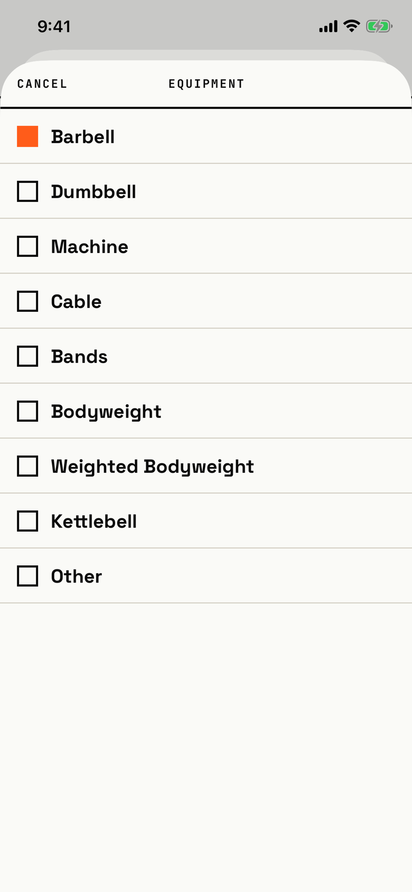

The lifter picks the one kind of equipment a custom exercise uses.

## Entry points

| From | Tap | Kind |
|---|---|---|
| [custom-exercise](custom-exercise.md) | The EQUIPMENT row | sheet |

## Exits

| Control | Goes to | Kind | Closes with |
|---|---|---|---|
| CANCEL | [custom-exercise](custom-exercise.md), with the equipment kept | sheet | cancel |
| An equipment row | [custom-exercise](custom-exercise.md), with that equipment set | sheet | verb |
| A drag down | [custom-exercise](custom-exercise.md), with the equipment kept | sheet | cancel |

## States

| State | How to reach it | Screenshot |
|---|---|---|
| Main: CANCEL, EQUIPMENT, nine rows from Barbell to Other, Barbell marked with a filled orange square | W01: editor > EQUIPMENT | [main](img/17e-default-light-equipment-picker.png) |
| Another kind picked | Not captured: the tour closes the sheet by picking the current Barbell | - |
| AX3, on both phones: the header puts EQUIPMENT above CANCEL and "Weighted Bodyweight" wraps | Main launch at AX3 | [AX3](img/17e-ax3-light-equipment-picker.png), [Pro Max, AX3](img/17promax-ax3-light-equipment-picker.png) |

Dark mode and the Pro Max at default text change only colour and size: [dark](img/17e-default-dark-equipment-picker.png), [Pro Max](img/17promax-default-light-equipment-picker.png).

## Compared with the mock-up

No mock-up was drawn for the equipment picker; the May custom exercise mock-up shows Equipment as one cell of a classification grid.

## VoiceOver order

1. "Cancel"
2. "Equipment"
3. "Barbell", selected
4. "Dumbbell"
5. "Machine"
6. Each other kind, ending with "Other"

Gaps: none found; the current kind carries the selected trait.
Rows are 52 pt tall and full width; CANCEL is 44 pt tall.

## Findings

<!-- findings are linked after the audit -->
