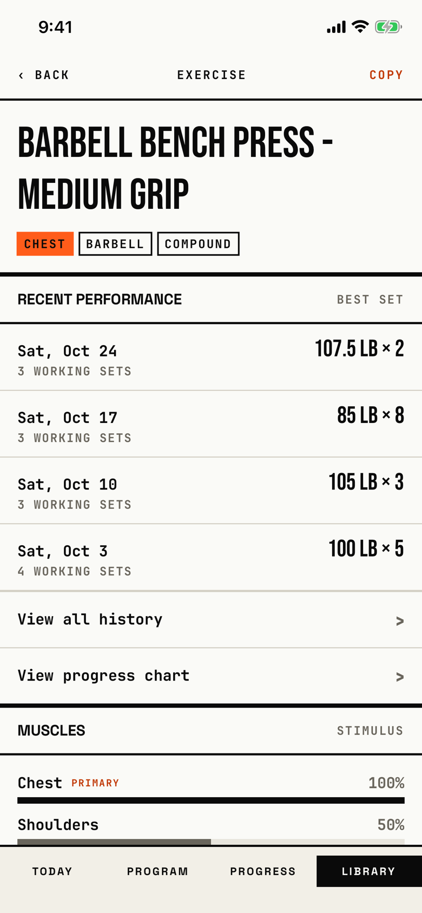

The lifter checks an exercise's recent best sets, muscles and how-to, and sets its increment, bar weight, unit and plateau rules.

## Entry points

| From | Tap | Kind |
|---|---|---|
| [library](library.md) | An exercise row | push |

In the picker mode of the same view, [library-picker](library-picker.md), a row adds the exercise instead, so the detail opens only from the Library tab.

## Exits

| Control | Goes to | Kind | Closes with |
|---|---|---|---|
| ‹ BACK | [library](library.md) | push | back |
| COPY in the header, on a built-in exercise | [custom-exercise](custom-exercise.md), named "<name> (Copy)" | sheet | cancel |
| COPY AS CUSTOM EXERCISE at the bottom, on a built-in exercise | [custom-exercise](custom-exercise.md), the same copy | sheet | cancel |
| EDIT in the header, on a custom exercise | [custom-exercise](custom-exercise.md), "Edit exercise" | sheet | cancel |
| View all history › | [exercise-history](exercise-history.md) | push | back |
| View progress chart ›, shown only when a set is logged | [exercise-progress](exercise-progress.md) | push | back |

The increment and bar weight fields, the unit chips and the plateau switch and steppers save as they change; there is no Save.

## States

| State | How to reach it | Screenshot |
|---|---|---|
| Main: a built-in bench press with four logged workouts, RECENT PERFORMANCE with BEST SET, both link rows | W13 (Main): search "Barbell Bench Press" > the Medium Grip row | [main](img/17e-default-light-exercise-detail.png) |
| With history (the same shot as Main, from the W13 walk) | W13: the same path | [with history](img/17e-default-light-exercise-detail--with-history.png) |
| Lower part: HOW TO steps, PRESCRIPTION SETTINGS, the PLATEAU DETECTION head | W13: the detail scrolled twice | [lower](img/17e-default-light-exercise-detail--lower.png) |
| Not logged: "Not logged yet. Your best set from each workout will show here.", no BEST SET label, no progress link | W01: Chest and Barbell filters > bench row | [not logged](img/17e-default-light-exercise-detail--not-logged.png) |
| One recent workout, while a workout is in progress | W03b: Library > bench row | [recent](img/17e-default-light-exercise-detail--recent.png) |
| Custom exercise: EDIT in the header, a CUSTOM chip, no HOW TO, no copy button | W01: save "Zercher Probe" > its row | [custom](img/17e-default-light-exercise-detail--custom.png) |
| Plateau override on: Window and Tolerance steppers and USE GLOBAL DEFAULTS | Not captured: the tour does not flip the switch | - |
| A unit chip set to kg or lb | Not captured: the tour leaves System default | - |
| AX3: the header puts EXERCISE above ‹ BACK and COPY, the title wraps to three lines, "RECENT PERFORMANCE" breaks as "PERFORMANC" over "E", and the date "Sat, Oct 24" breaks after the comma | Main launch at AX3 | [AX3](img/17e-ax3-light-exercise-detail.png) |
| Pro Max, AX3: the header stacks as on the 17e, but the title takes two lines, "RECENT / PERFORMANCE" breaks between the words, and each date fits on one line | Main launch at AX3 | [Pro Max, AX3](img/17promax-ax3-light-exercise-detail.png) |

Dark mode and the Pro Max at default text change only colour and size: [dark](img/17e-default-dark-exercise-detail.png), [Pro Max](img/17promax-default-light-exercise-detail.png).

## Compared with the mock-up

| In the mock-up | In the app | Difference |
|---|---|---|
| Header "‹ LIBRARY" with EDIT on the right | "‹ BACK", title EXERCISE, COPY on a built-in and EDIT on a custom exercise | The back label is generic and built-ins copy instead of edit. |
| Tags above the name, including a pattern tag (HORIZONTAL PUSH) | Tags below the name: primary muscle filled orange, equipment, mechanic | No pattern tag, and the muscle tag is filled with the accent. |
| A muscle line "PRIMARY: CHEST 1.0 · SECONDARY: …" | A MUSCLES section with a bar and a percent per muscle | Stimulus is drawn as bars. |
| An ink panel with EST. 1 REP MAX, a 30-day change and a sparkline | No e1RM panel; a "View progress chart" link instead | The hero number and chart are gone from the detail. |
| The full log with intent chips and a PR footer | RECENT PERFORMANCE with up to five best sets and a "View all history" link | The log moved to [exercise-history](exercise-history.md). |
| No settings | HOW TO, PRESCRIPTION SETTINGS, PLATEAU DETECTION and a copy button | The app adds editing to a read screen. |

## VoiceOver order

1. "BACK"
2. "Exercise"
3. "Copy"
4. "Barbell Bench Press - Medium Grip", then "Chest", "Barbell", "Compound"
5. "Recent performance", "Best set"
6. "Sat, Oct 24, 3 working sets, 107.5 lb × 2"
7. "View all history, ›"
8. "Chest, primary, 100 percent"

Gaps: the link rows read the "›" glyph as part of their label.
The KG and LB unit chips are 27.7 pt wide, under the 44 pt minimum.
The two copy controls, "Copy" and "Copy as Custom Exercise", do the same thing.

## Findings

<!-- findings are linked after the audit -->
