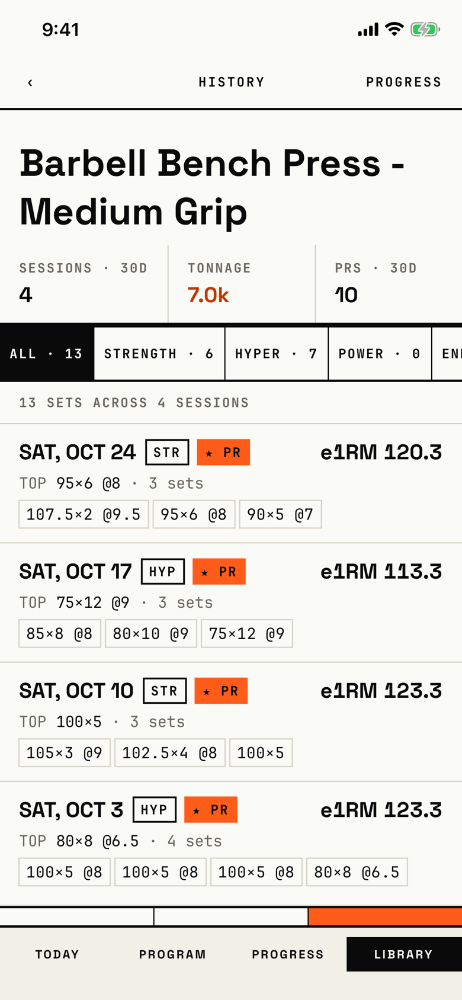

The lifter reads every logged workout of one exercise, newest first, and can narrow the list to one training intent.
Its header reads "History", the same word as the [history](history.md) list of all workouts.

## Entry points

| From | Tap | Kind |
|---|---|---|
| [exercise-detail](exercise-detail.md) | View all history › | push |

## Exits

| Control | Goes to | Kind | Closes with |
|---|---|---|---|
| ‹ in the header | [exercise-detail](exercise-detail.md) | push | back |
| PROGRESS in the header, shown while the list has sets | [exercise-progress](exercise-progress.md) | push | back |
| ALL, STRENGTH, HYPER, POWER, ENDUR and TECH chips | stays here, filtered | none | none |
| SHOW ALL in the empty intent state | stays here, filter cleared | none | none |

The workout rows have no action, so a row does not open its workout.

## States

| State | How to reach it | Screenshot |
|---|---|---|
| Main: four bench workouts, a stat strip (SESSIONS · 30D, TONNAGE, PRS · 30D), intent chips, one row per workout and the TOP WEIGHT, TOP REPS, VOL PR footer | W13 (Main): exercise detail > View all history | [main](img/17e-default-light-exercise-history.png) |
| STRENGTH picked: two rows, "6 SETS ACROSS 4 SESSIONS" | W13: STRENGTH chip | [intent](img/17e-default-light-exercise-history--intent.png) |
| POWER picked with no sets: "No Power sets", "Try a different intent filter.", SHOW ALL; PROGRESS leaves the header | W13: POWER chip | [intent empty](img/17e-default-light-exercise-history--intent-empty.png) |
| Nothing logged: "No logged sets yet", "Log this exercise in a workout to see history.", no PROGRESS | W01: detail of an unlogged bench press > View all history | [empty](img/17e-default-light-exercise-history--empty.png) |
| One finished workout while a second is in progress: SESSIONS · 30D reads 2 and the count line reads "3 SETS ACROSS 2 SESSIONS" | W03b: detail > View all history | [one workout](img/17e-default-light-exercise-history--one-workout.png) |
| A workout logged today, whose row reads TODAY | Not captured: no seed finishes a bench workout today | - |
| AX3, on both phones: the header puts HISTORY above ‹ and PROGRESS, and the stat strip stacks into three rows | Main launch at AX3 | [AX3](img/17e-ax3-light-exercise-history.png), [Pro Max, AX3](img/17promax-ax3-light-exercise-history.png) |

Dark mode and the Pro Max at default text change only colour and size; the Pro Max shows ENDUR cut at the edge where the 17e cuts it after "END": [dark](img/17e-default-dark-exercise-history.png), [Pro Max](img/17promax-default-light-exercise-history.png).

## Compared with the mock-up

The May exercise detail mock-up drew this log on the detail itself.

| In the mock-up | In the app | Difference |
|---|---|---|
| The log sits under the exercise's e1RM panel on one screen | The log is its own pushed screen titled HISTORY | The log moved off the detail. |
| Three intent chips filling the width (ALL, STRENGTH, HYPER) | Six chips in a sideways strip; ENDUR and TECH are off screen at 390 pt | More intents, and the strip scrolls. |
| Dates in condensed caps ("THU MAY 16"), e1RM in condensed caps | Dates and e1RM in bold Space Grotesk ("SAT, OCT 24", "e1RM 120.3") | A different face for the row head. |
| The PR set chip is filled orange | Set chips are all outlined; only the "★ PR" tag is filled | The PR set is not marked inside the row. |
| A stat strip is absent; the footer shows TOP WEIGHT with its month, TOP REPS with its weight | A stat strip on top, and a footer with bare numbers | Footer values lose their context line. |

## VoiceOver order

1. "Back"
2. "History"
3. "PROGRESS"
4. "Barbell Bench Press - Medium Grip"
5. "Sessions · 30d", value "4"
6. "ALL · 13", selected
7. "13 SETS ACROSS 4 SESSIONS"
8. "SAT, OCT 24", "STR", "★ PR", "e1RM 120.3", "TOP ", "95×6 @8", " · 3 sets"

Gaps: each workout row is read as seven or more separate fragments instead of one element.
The chips use abbreviations ("HYPER", "ENDUR", "TECH") that VoiceOver reads as written.
All controls are at least 44 pt; the back button is exactly 44 by 44 pt.

## Findings

<!-- findings are linked after the audit -->
