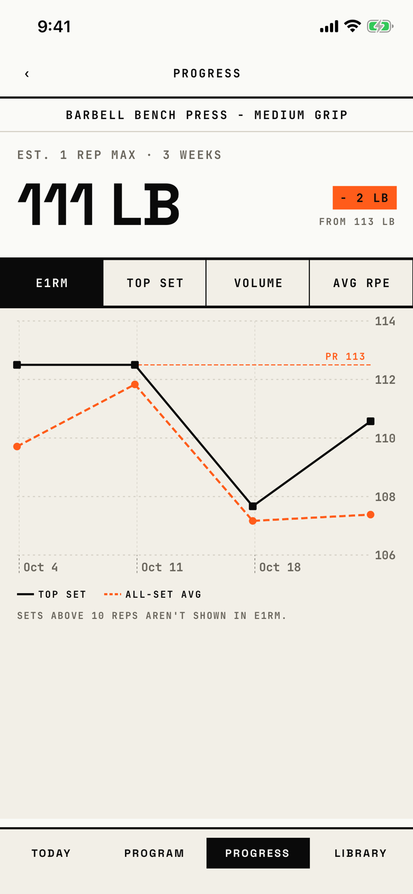

The lifter reads one exercise's trend: its e1RM, top set, volume or average RPE over time.
Its header reads "Progress", the same word as the [progress](progress.md) tab.

## Entry points

| From | Tap | Kind |
|---|---|---|
| [progress](progress.md) | an exercise row under Recent | push |
| [exercise-detail](exercise-detail.md) | View progress chart | push |
| [exercise-history](exercise-history.md) | PROGRESS in the header | push |

## Exits

| Control | Goes to | Kind | Closes with |
|---|---|---|---|
| ‹ (read as "Back") | the screen that opened it | push | back |
| E1RM, TOP SET, VOLUME and AVG RPE chips | this screen, redrawn for the chosen series | none | none |

## States

| State | How to reach it | Screenshot |
|---|---|---|
| e1RM, four workouts | W13 seed, Progress > Barbell Bench Press | [main](img/17e-default-light-exercise-progress.png) |
| AVG RPE | the AVG RPE chip: one line per intent | [avg-rpe](img/17e-default-light-exercise-progress--avg-rpe.png) |
| e1RM with its caption | the e1RM chip again; the caption "Sets above 10 reps aren't shown in e1RM." is already in the main state, so this matches it | [e1rm-caption](img/17e-default-light-exercise-progress--e1rm-caption.png) |
| One workout | W03 demo seed: no hero, chips, then "Not enough data" and "Log 2 sessions to see your trend." | [one-workout](img/17e-default-light-exercise-progress--one-workout.png) |
| TOP SET | the TOP SET chip: the top-set line and the PR rule | [top-set](img/17e-default-light-exercise-progress--top-set.png) |
| VOLUME | the VOLUME chip: one line per intent; the hero still shows e1RM | [volume](img/17e-default-light-exercise-progress--volume.png) |
| AX3 | On both phones the header stacks, "111 LB" wraps onto two lines, and the chips form a 2 by 2 grid; the name takes three lines on the 17e and two on the Pro Max, where the chart's top edge shows at the bottom of the first screen | [ax3](img/17e-ax3-light-exercise-progress.png), [Pro Max, AX3](img/17promax-ax3-light-exercise-progress.png) |
| AVG RPE with fewer than two RPE workouts | not captured: every seeded workout logs RPE; it reads "Log RPE in 2 workouts to see your trend." | none |

Dark mode and the Pro Max at default text change only colour and size; in dark mode the top-set line turns paper-white: [dark](img/17e-default-dark-exercise-progress.png), [Pro Max](img/17promax-default-light-exercise-progress.png).

## Compared with the mock-up

| In the mock-up | In the app | Difference |
|---|---|---|
| Header "BENCH · PROGRESS" with an EXPORT action | Header "PROGRESS" with no right action, and the full exercise name on its own row | The export is gone and the name moved out of the header |
| Hero "248 LB" in condensed caps | Hero "111 LB" in Space Grotesk | Different face |
| "+ 36 LB" signal chip for a rise | "- 2 LB" signal chip, also for a drop | The app uses the signal colour for any change |
| The e1RM legend splits by intent, "HYPERTROPHY · 9 SESSIONS" and "STRENGTH · 5 SESSIONS" | e1RM splits TOP SET and ALL-SET AVG; only VOLUME and AVG RPE split by intent | Different series |
| An area fill under the top-set line | Lines and points only | No fill |
| X axis W1 to W12 | Dates such as "Oct 4" | Calendar dates instead of week numbers |
| A PERSONAL RECORDS strip under the chart | No records here; they live on [prs](prs.md) for every exercise | Records moved to another screen |

## VoiceOver order

1. "Back" (button)
2. "Progress" (header)
3. "Barbell Bench Press - Medium Grip" (header)
4. "EST. 1 REP MAX · 3 WEEKS", "111 LB", "- 2 LB", "FROM 113 LB"
5. "e1RM" (button, selected), "TOP SET", "VOLUME", "AVG RPE"
6. "PR 113"
7. "Top set, Oct 3, 2026", 113 lb, then each point by date
8. "Top set", "All-set avg", and the caption

Gaps: "- 2 LB" is read as "minus 2 LB" with no word for what changed; the points say Oct 3 while the axis shows Oct 4; the audio graph reads unrounded values with no unit (T98).

## Findings

- Minor: [D-34](../audit.md#d-34), [D-68](../audit.md#d-68), [D-74](../audit.md#d-74), [D-75](../audit.md#d-75), [D-76](../audit.md#d-76), [D-77](../audit.md#d-77), [D-78](../audit.md#d-78), [D-79](../audit.md#d-79), [D-80](../audit.md#d-80).
- Polish: [D-249](../audit.md#d-249), [D-250](../audit.md#d-250).
