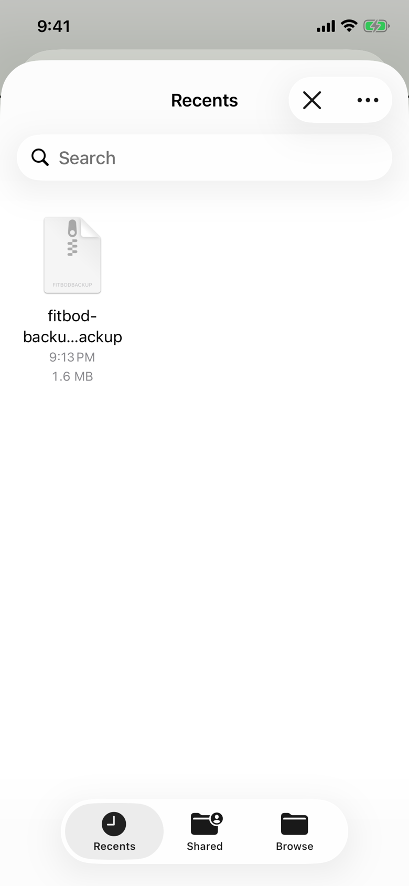

The lifter picks a Fitbod backup file to restore from.
iOS draws the header, which reads "Recents" when the picker opens.

## Entry points

| From | Tap | Kind |
|---|---|---|
| [settings](settings.md) | RESTORE in the Backup panel | sheet |

iOS draws this sheet; the app presents it with one file at a time and only the `.fitbodbackup` type, so other files cannot be picked.
The app gives no warning before the picker; the warning comes after a file is picked.

## Exits

| Control | Goes to | Kind | Closes with |
|---|---|---|---|
| ✕ (VoiceOver "Cancel") | [settings](settings.md) | sheet | close |
| A backup file | [dialog-restore-confirm](dialog-restore-confirm.md), after the app checks the file | dialog | verb |
| A backup file that fails the check | [dialog-restore-error](dialog-restore-error.md) | dialog | verb |
| Recents, Shared, Browse | other places in the picker | none | none |

## States

| State | How to reach it | Screenshot |
|---|---|---|
| Recents with one backup | W02: save a backup to Files through the share sheet, then RESTORE | [main](img/17e-default-light-file-importer.png) |

The Pro Max at default text changes only size: [Pro Max](img/17promax-default-light-file-importer.png).
The dark and AX3 versions were not captured: the picker is only reached in the W02 walk, which runs in light mode at default text.
The file in the shot is named `fitbod-backup-10A3F9D2.fitbodbackup`, because the tour types a unique name in the Files save sheet; the app's own name carries the date.

## Compared with the mock-up

No mock-up was drawn for this sheet; the May Settings mock-up draws RESTORE as the signal button, and the app draws CREATE as the signal button instead.

## VoiceOver order

1. Recents
2. Cancel
3. More
4. fitbod-backup-10A3F9D2.fitbodbackup, 9:13 PM, 1.6 MB
5. Recents, Selected
6. Shared
7. Browse

Gaps:

- None that the app controls; Cancel and More measure 36 pt tall in iOS's own header.

## Findings

The audit has no row for this file.
