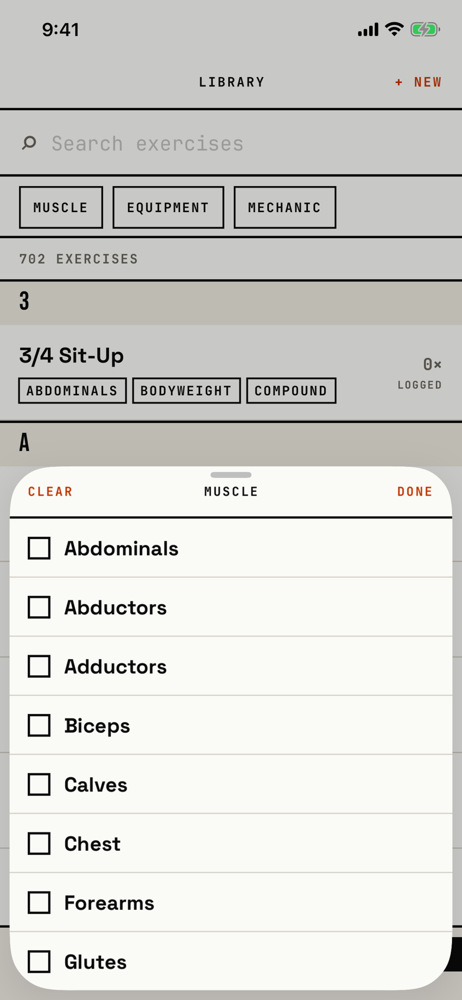

The lifter ticks the muscles, equipment or mechanic that the exercise list should keep.

## Entry points

| From | Tap | Kind |
|---|---|---|
| [library](library.md) | The MUSCLE, EQUIPMENT or MECHANIC chip | sheet |
| [library-picker](library-picker.md) | The same chips in the exercise picker | sheet |

The sheet opens at half height and can be dragged to full height.
Its title is the facet: "Muscle", "Equipment" or "Mechanic".

## Exits

| Control | Goes to | Kind | Closes with |
|---|---|---|---|
| DONE | [library](library.md) or [library-picker](library-picker.md) | sheet | done |
| A drag down or a tap above the sheet | the screen behind | sheet | done |
| CLEAR | stays here, with this facet emptied | none | none |
| A row | stays here, with the row ticked or unticked; the list behind updates at once | none | none |

## States

| State | How to reach it | Screenshot |
|---|---|---|
| Main: Muscle, nothing ticked | W13: Library > MUSCLE | [main](img/17e-default-light-filter-picker.png) |
| Muscle with Chest ticked; the chip behind reads MUSCLE · 1 and CLEAR FILTERS appears | W01: MUSCLE > Chest | [muscle](img/17e-default-light-filter-picker--muscle.png) |
| Equipment with Barbell ticked | W01: EQUIPMENT > Barbell | [equipment](img/17e-default-light-filter-picker--equipment.png) |
| Mechanic with nothing ticked: two rows and an empty lower half | W01: MECHANIC | [mechanic](img/17e-default-light-filter-picker--mechanic.png) |
| Mechanic with one value picked; a second tap on it unticks it, and picking the other replaces it | Not captured: the tour leaves Mechanic unpicked | - |
| Pattern | Not captured: the chip is hidden until the catalog has pattern metadata, by product decision | - |
| AX3, on both phones: the header puts MUSCLE above CLEAR and DONE | Main launch at AX3 | [AX3](img/17e-ax3-light-filter-picker.png), [Pro Max, AX3](img/17promax-ax3-light-filter-picker.png) |

Dark mode and the Pro Max at default text change only colour and size; the taller Pro Max sheet shows all nine equipment rows: [dark](img/17e-default-dark-filter-picker.png), [Pro Max](img/17promax-default-light-filter-picker.png).

## Compared with the mock-up

No mock-up was drawn for the filter sheet; the May Library mock-up picks values from chips on the screen itself.

## VoiceOver order

1. "Sheet Grabber", "Half screen"
2. "Clear"
3. "Muscle"
4. "Done"
5. "Abdominals", then each muscle; a ticked row adds "Selected"

Gaps: the tick square is drawn, not read, so the state comes only from the selected trait.
Mechanic allows one value, but its rows read exactly like the multi-choice rows.
Rows are 50 pt tall and full width; CLEAR and DONE are 44 pt tall.

## Findings

- Polish: [D-253](../audit.md#d-253), [D-254](../audit.md#d-254), [D-255](../audit.md#d-255).
