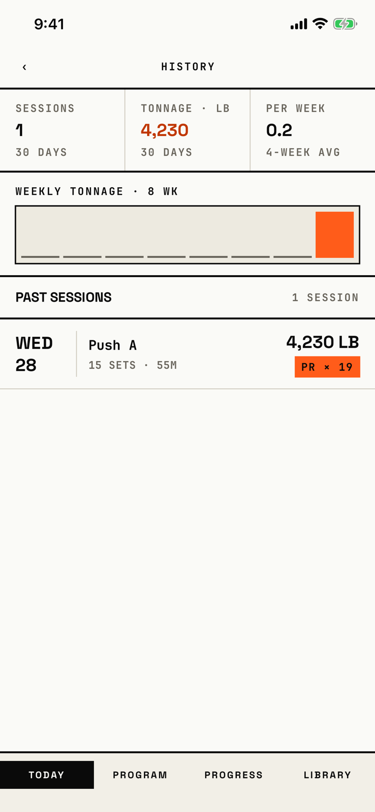

The lifter scans past workouts, newest first, with 30-day totals and an 8-week tonnage chart.

## Entry points

| From | Tap | Kind |
|---|---|---|
| [today](today.md) | the SESSIONS stat | push |
| [progress](progress.md) | Workouts row | push |

## Exits

| Control | Goes to | Kind | Closes with |
|---|---|---|---|
| ‹ (header, left) | the screen it came from | push | back |
| A workout row | [workout-summary](workout-summary.md) | push | back |

## States

| State | How to reach it | Screenshot |
|---|---|---|
| One workout, from Today | main tour, demo seed, Today, SESSIONS | [main](img/17e-default-light-history.png) |
| No workouts | W01, fresh store, Progress, Workouts: "No sessions yet" | [empty](img/17e-default-light-history--empty.png) |
| Several weeks, from Progress | main tour, progress-history seed, Progress, Workouts | [from-progress](img/17e-default-light-history--from-progress.png) |
| Eight weeks of tonnage | W14, weekly-tonnage seed | [spark](img/17e-default-light-history--spark.png) |
| A workout with no sets in the list | W06, empty-between seed | [with-empty](img/17e-default-light-history--with-empty.png) |
| AX3 | On both phones the header title sits above the "‹" and the stats stack one per row, so no workout row shows above the tab bar; the earlier 17e capture of the main state showed row dates breaking across lines. The WEEKLY TONNAGE head runs into its delta on the 17e ("· 8↓ 30.3%", with WK cut off) and wraps over three lines on the Pro Max | [ax3](img/17e-ax3-light-history.png), [ax3 from Progress](img/17e-ax3-light-history--from-progress.png), [Pro Max AX3](img/17promax-ax3-light-history.png), [Pro Max AX3 from Progress](img/17promax-ax3-light-history--from-progress.png) |

Dark mode and the Pro Max at default text change only colour and size: [dark](img/17e-default-dark-history.png), [dark from Progress](img/17e-default-dark-history--from-progress.png), [Pro Max](img/17promax-default-light-history.png), [Pro Max empty](img/17promax-default-light-history--empty.png), [Pro Max from Progress](img/17promax-default-light-history--from-progress.png), [Pro Max spark](img/17promax-default-light-history--spark.png), [Pro Max with-empty](img/17promax-default-light-history--with-empty.png).
The date column keeps its fixed width on the Pro Max, so "WED 28" still breaks onto two lines there.

## Compared with the mock-up

| In the mock-up | In the app | Difference |
|---|---|---|
| "‹" HISTORY with FILTER on the right | "‹" History, no FILTER | No filter in the app |
| Stats SESSIONS · 30D, TONNAGE, ADHERENCE 93% | SESSIONS 30 DAYS, TONNAGE · LB, PER WEEK 4-WEEK AVG | Per-week average replaces adherence |
| WEEKLY TONNAGE · 8 wk with "↑ 12.4%" and the current week in orange | Same chart without the change figure | No week-over-week change |
| Date column "TODAY / WED 22", "MON 20" on one line | "WED 28" and other dates break onto two lines in some rows | Uneven date column |
| PR chips "PR · E1RM", "PR · WEIGHT", rows without a PR show › | "PR × 19" style chip with a count | The app counts records instead of naming the kind |

## VoiceOver order

1. "Back" (button)
2. "History"
3. "Sessions in the last 30 days", value "1"
4. "Tonnage in the last 30 days, pounds", value "4,230"
5. "Sessions per week, last 4 weeks", value "0.2"
6. "WEEKLY TONNAGE · 8 WK"
7. "Past sessions", "1 session"
8. "Push A, Wednesday, October 28, 15 sets, 55 minutes, 4,230 pounds total, 19 p…" (button)

Gaps: the back button is a bare "‹" glyph on screen.
The tonnage chart has no summary label.

## Findings

<!-- findings are linked after the audit -->
