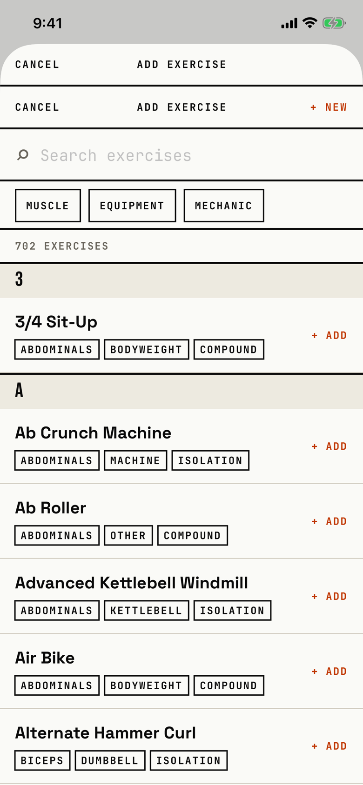

The lifter finds an exercise in the library and adds it to the workout or to the session being edited.

## Entry points

| From | Tap | Kind |
|---|---|---|
| [logger](logger.md) | + ADD EXERCISE ↘ FROM LIBRARY under the last exercise | sheet |
| [session-editor](session-editor.md) | + Add exercise ↘ FROM LIBRARY | sheet |

## Exits

| Control | Goes to | Kind | Closes with |
|---|---|---|---|
| Any exercise row, which reads "+ ADD" | [logger](logger.md), with the exercise added with three sets, or [session-editor](session-editor.md), with it added to the draft | sheet | verb |
| CANCEL | [logger](logger.md) or [session-editor](session-editor.md) | sheet | cancel |
| + NEW | [custom-exercise](custom-exercise.md) | sheet | cancel |
| MUSCLE, EQUIPMENT or MECHANIC | [filter-picker](filter-picker.md) | sheet | done |

From the logger the sheet shows two headers, one above the other: "CANCEL / ADD EXERCISE" from the logger's button, then the library's own "CANCEL / ADD EXERCISE / + NEW" (`fitbod/Sessions/AddUnplannedExerciseButton.swift:50`, `fitbod/ExerciseLibrary/ExerciseLibraryView.swift:102`).
From the session editor only the library's header shows.
The list is the library's: a search field, three filter chips, a count, and A to Z sections.
A tap anywhere on a row adds the exercise and closes the sheet; there is no exercise detail here.

## States

| State | How to reach it | Screenshot |
|---|---|---|
| From the logger | W03 demo: + ADD EXERCISE under the last exercise | [main](img/17e-default-light-library-picker.png) |
| From the session editor | W15 routines: a new session, + Add exercise | [from-editor](img/17e-default-light-library-picker--from-editor.png) |
| Searched | The same, type "Barbell Bench Press - Medium Grip" | [search](img/17e-default-light-library-picker--search.png) |
| No results | Not captured: the list offers to create a custom exercise with the typed name | - |
| AX3 | On both phones both stacked headers put ADD EXERCISE above CANCEL (and + NEW), the filter chip row is cut at the right edge ("M" on the 17e, "MEC" on the Pro Max), and each exercise row stacks its chips in one column, so the first screen shows only 3/4 Sit-Up | [ax3](img/17e-ax3-light-library-picker.png), [Pro Max ax3](img/17promax-ax3-light-library-picker.png) |
| Pro Max, searched | Same as the searched state; "Barbell Bench Press - Medium Grip" fits on one line, where the 17e wraps it to two | [Pro Max search](img/17promax-default-light-library-picker--search.png) |

Dark mode and the Pro Max at default text change only colour and size: [dark](img/17e-default-dark-library-picker.png), [Pro Max](img/17promax-default-light-library-picker.png), [Pro Max from-editor](img/17promax-default-light-library-picker--from-editor.png).

## Compared with the mock-up

| In the mock-up | In the app | Difference |
|---|---|---|
| "PICK EXERCISES" with check boxes, to add several at once | One tap adds one exercise and closes the sheet | Several exercises need several trips |
| Filter chips ALL, CHEST, BACK, + EQUIPMENT, CUSTOM | MUSCLE, EQUIPMENT and MECHANIC chips that open pickers | Filters sit one step deeper |
| A use count on each row | Muscle, equipment and mechanic tags | No usage count |
| A SELECTED footer with CANCEL and a signal ADD 2 EXERCISES ▸ | CANCEL and + NEW in the header, "+ ADD" on every row | No confirm button |

## VoiceOver order

1. Search exercises
2. MUSCLE
3. EQUIPMENT
4. MECHANIC
5. 702 EXERCISES
6. 3/4 Sit-Up, Abdominals, Bodyweight, Compound
7. CANCEL
8. ADD EXERCISE

Gaps:

- From the logger, VoiceOver meets two CANCEL buttons and two "ADD EXERCISE" titles.
- The headers are drawn in safe-area insets and come last in the tree (`screens/tree/library-picker.txt:289`).
- Each row's visible "+ ADD" is not part of its label.

## Findings

<!-- findings are linked after the audit -->
