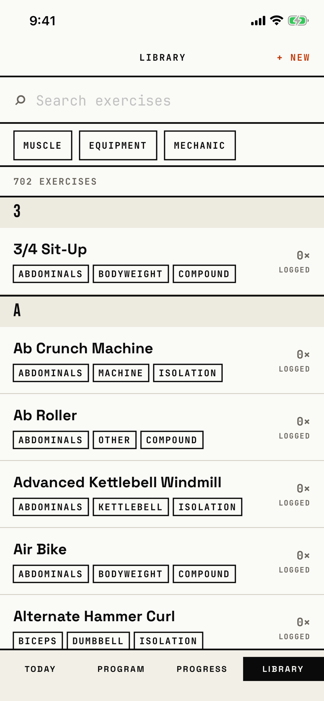

The lifter searches and filters the 702-exercise catalog, opens an exercise, or starts a custom exercise.

## Entry points

| From | Tap | Kind |
|---|---|---|
| Tab bar | LIBRARY, from any tab root; a second tap clears the tab's stack | tab switch |

The tab bar is not a screen, so a tab switch is not a navigation edge.
The same view also draws the exercise picker, [library-picker](library-picker.md), when a host passes `onSelect`; that mode is its own screen file.

## Exits

| Control | Goes to | Kind | Closes with |
|---|---|---|---|
| + NEW in the header | [custom-exercise](custom-exercise.md) | sheet | cancel |
| CREATE CUSTOM EXERCISE in the no-match state, with the search text as the name | [custom-exercise](custom-exercise.md) | sheet | cancel |
| MUSCLE, EQUIPMENT or MECHANIC chip | [filter-picker](filter-picker.md) | sheet | done |
| An exercise row | [exercise-detail](exercise-detail.md) | push | back |
| CLEAR FILTERS chip, × in the search field | stays here | none | none |

## States

| State | How to reach it | Screenshot |
|---|---|---|
| Main: the whole catalog, "702 EXERCISES", letter sections | W13: Library tab | [main](img/17e-default-light-library.png) |
| Filtered: CLEAR FILTERS, MUSCLE · 1, EQUIPMENT · 1, "10 MATCHES" | W01: Chest and Barbell picked in the filter sheets | [filtered](img/17e-default-light-library--filtered.png) |
| No match for a search: dashed "0", "No exercises match "Zercher Probe"", CREATE CUSTOM EXERCISE | W01: clear filters, search "Zercher Probe" | [no matches](img/17e-default-light-library--no-matches.png) |
| No match for filters alone: "No exercises match", "Try fewer filters or a different name.", CLEAR FILTERS | Not captured: no pair of catalog filters the tour picks leaves zero exercises | - |
| AX3, on both phones: the header puts LIBRARY above + NEW, the tab bar uses two columns, tag chips wrap, and the filter chip row runs off the right edge with MECHANIC cut | Main launch at AX3 | [AX3](img/17e-ax3-light-library.png), [Pro Max, AX3](img/17promax-ax3-light-library.png) |
| Pro Max, filtered: "Barbell Bench Press - Medium Grip" fits on one line, and the chip row starts scrolled so CLEAR FILTERS is cut to "R FILTERS" | same as Filtered | [Pro Max, filtered](img/17promax-default-light-library--filtered.png) |
| Pro Max, no matches: the headline "No exercises match "Zercher Probe"" and the help line each fit on one line | same as No match for a search | [Pro Max, no matches](img/17promax-default-light-library--no-matches.png) |

Dark mode and the Pro Max at default text change only colour and size: [dark](img/17e-default-dark-library.png), [Pro Max](img/17promax-default-light-library.png).

## Compared with the mock-up

| In the mock-up | In the app | Difference |
|---|---|---|
| A back "‹" on the left of the header | No left action | The Library is a tab root, so it has no back control. |
| Search shows "8 / 812" on the right | The count sits in its own row under the chips ("10 MATCHES") | The count moved below the filter row. |
| Chips are ALL, picked values with "×", then "+ EQUIPMENT", "+ PATTERN" | MUSCLE, EQUIPMENT and MECHANIC chips that open a sheet, with a count when active, plus CLEAR FILTERS | Values are picked in a sheet, not removed one by one; Pattern is hidden until the catalog has pattern data, by product decision. |
| A four-cell facet summary (MUSCLE Chest, EQUIP Barbell, MECH Any, PATTERN Any) | No summary strip | The app drops the summary row. |
| A star on each row for favourites, and a tinted row for a favourite | No stars | Favourites were not built. |
| Picked chips are filled orange | Active chips are filled orange | Same, and it differs from the ink selected state in `docs/design-system/interaction.md`. |

## VoiceOver order

1. "Library"
2. "+ New"
3. "Search exercises", text field
4. "Muscle filter", "Equipment filter", "Mechanic filter"
5. "702 EXERCISES"
6. "3", then "3/4 Sit-Up, Abdominals, Bodyweight, Compound, Logged 0 times"

Gaps: the letter section heads "3" and "A" carry the header trait in code but read as a bare letter.
The magnifier glyph is hidden, as it should be.
Every target in the tree is at least 44 pt tall; the filter chips are 44 pt.

## Findings

- Minor: [D-65](../audit.md#d-65), [D-81](../audit.md#d-81), [D-82](../audit.md#d-82), [D-83](../audit.md#d-83).
- Polish: [D-261](../audit.md#d-261), [D-262](../audit.md#d-262), [D-263](../audit.md#d-263), [D-264](../audit.md#d-264).
