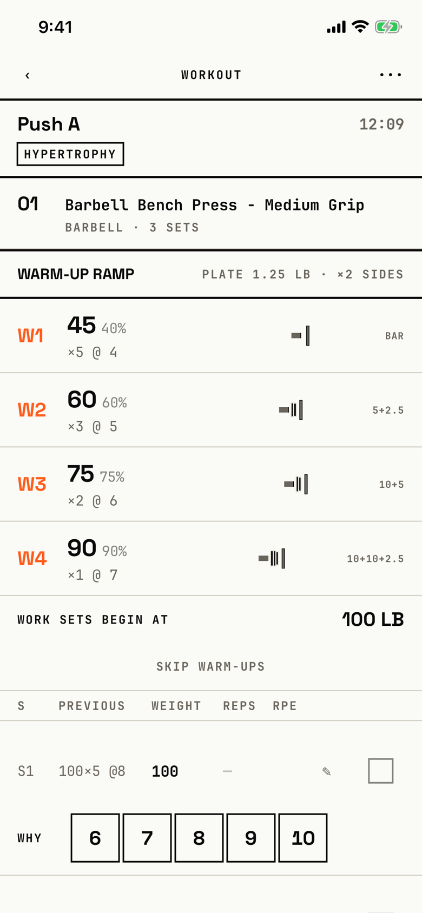

The lifter logs a workout set by set: weight, reps and RPE for each set, with the warm-up ramp, the rest timer and personal records in the same scrolling list.

## Entry points

| From | Tap | Kind |
|---|---|---|
| [today](today.md) | RESUME on the black resume slab, or START WORKOUT ▸ on Today's slab | push |
| [program](program.md) | Resume ▸ on the resume banner | push |
| [session-template-detail](session-template-detail.md) | START WORKOUT ▸, or Resume in the Workout in progress alert | push |

## Exits

| Control | Goes to | Kind | Closes with |
|---|---|---|---|
| ‹ (Back) | [today](today.md), [program](program.md) or [session-template-detail](session-template-detail.md), whichever opened it; the workout stays in progress | push | back |
| ••• (More) | [dialog-workout-menu](dialog-workout-menu.md) | dialog | none |
| Mark set complete, the first time a rest starts on this install | [notification-permission](notification-permission.md) | system | none |
| The rest dock's countdown row | [rest-timer](rest-timer.md) | sheet | done |
| WHY beside an open set | [why-this-weight](why-this-weight.md) | sheet | verb |
| A long press on an RPE chip | [decimal-rpe-picker](decimal-rpe-picker.md) | sheet | done |
| ✎ (Note for set n) | [per-set-note](per-set-note.md) | sheet | verb |
| A long press on the exercise name, then Swap Exercise… | [swap-exercise](swap-exercise.md) | sheet | verb |
| A long press on the exercise name, then Edit Pinned Note, or a tap on the pinned note capsule | [pinned-note](pinned-note.md) | sheet | verb |
| A long press on the exercise name, then Remove from Session | [dialog-remove-exercise](dialog-remove-exercise.md) | dialog | verb |
| + ADD EXERCISE ↘ FROM LIBRARY under the last exercise | [library-picker](library-picker.md) | sheet | verb |
| TRY VARIATION chip on a stalled exercise | [try-variation](try-variation.md) | sheet | done |
| CONSIDER DELOAD chip on a stalled exercise | [fatigue-signals](fatigue-signals.md) | sheet | done |
| Finish in the Finish workout? dialog | [workout-summary](workout-summary.md) | cover | done |

Other controls act in place: the S1 set label opens the set-type menu, SKIP WARM-UPS hides the ramp with an UNDO line, + ADD SET adds a set, a swipe left on a set deletes it, and ADD VOLUME and DROP INTENSITY change the sets at once.
The tab bar is hidden, and the rest dock steps aside while the keyboard is up.
The plate stack under a working set never opens, because the weight cell's own tap wins over the row's tap; the orchestrator's table holds that problem.

## States

| State | How to reach it | Screenshot |
|---|---|---|
| Open, nothing logged | W03 demo: Today, RESUME | [main](img/17e-default-light-logger.png) |
| Warm-up ramp | The same, with the ramp's first row revealed | [warmup-ramp](img/17e-default-light-logger--warmup-ramp.png) |
| Previous column | The same, with the first "Previous" cell revealed | [previous](img/17e-default-light-logger--previous.png) |
| No previous workout | W15 routines: a new Push A started after a relaunch; every cell reads a dash | [no-previous](img/17e-default-light-logger--no-previous.png) |
| Warm-ups skipped | SKIP WARM-UPS; the ramp becomes "Warm-ups skipped" with UNDO | [warmups-skipped](img/17e-default-light-logger--warmups-skipped.png) |
| Warm-ups back | UNDO after skipping; the ramp returns | [warmups-undo](img/17e-default-light-logger--warmups-undo.png) |
| Set-type menu | Tap S1; Working, Warm-up, Drop Set, To Failure, Rest-Pause | [set-type-menu](img/17e-default-light-logger--set-type-menu.png) |
| Set logged, resting | Set 1 at 5 reps, then Mark set complete; the rest dock shows RESTING | [set-logged](img/17e-default-light-logger--set-logged.png) |
| Personal record | Set 1 at 9 reps; the PR banner covers the top | [pr-banner](img/17e-default-light-logger--pr-banner.png) |
| Resting | The dock right after the record set | [rest-resting](img/17e-default-light-logger--rest-resting.png) |
| Rest complete | -15s until the dock reads REST COMPLETE and counts up in signal red, and SKIP becomes DONE | [rest-complete](img/17e-default-light-logger--rest-complete.png) |
| Stalled | W04 stalled: the STALLED badge with the ADD VOLUME chip above the set table | [stalled](img/17e-default-light-logger--stalled.png) |
| Volume added | Tap ADD VOLUME; set S4 is added at once | [add-volume](img/17e-default-light-logger--add-volume.png) |
| Calibrating | W05 calibrating: a CALIBRATING badge, and set 1's weight is a read-only range "95 - 105 lb" | [calibrating](img/17e-default-light-logger--calibrating.png) |
| Plate stack open | Not captured: no tap opens it (see the orchestrator's table) | - |
| DROP INTENSITY, TRY VARIATION and CONSIDER DELOAD chips | Not captured: the stalled seed always suggests ADD VOLUME | - |
| Manual weight, with the M badge | Not captured: the tour types no weight | - |
| Rest-pause, tempo and partial-rep rows | Not captured: no seed sets these set types or tracking options | - |
| AX3 | The header puts WORKOUT above ‹ and •••, the exercise name wraps over three lines, and each set stacks weight, reps, ✎, the set square, WHY and the RPE chips in one column, so a working set is about 512 to 560 pt tall and the demo workout runs about 11,000 pt; with the rest dock up, less than one set fits between the header and the dock; this holds on both phones, except that on the Pro Max the exercise name wraps over two lines and the dock shows "Barbell B…" | [ax3](img/17e-ax3-light-logger.png), [ax3 set logged](img/17e-ax3-light-logger--set-logged.png), [ax3 ramp](img/17e-ax3-light-logger--warmup-ramp.png), [Pro Max ax3](img/17promax-ax3-light-logger.png), [Pro Max ax3 set logged](img/17promax-ax3-light-logger--set-logged.png), [Pro Max ax3 ramp](img/17promax-ax3-light-logger--warmup-ramp.png) |
| Pro Max, set logged | Same as the set-logged state; the capture still shows iOS's notification alert over the screen, because the tour had not answered it yet on this phone | [Pro Max set logged](img/17promax-default-light-logger--set-logged.png) |
| Pro Max, personal record | Same as the personal-record state; the banner's "WEIGHT PR · REP PR · VOLUME PR · E1RM PR" fits on one line, where the 17e wraps E1RM PR to a second line, so the banner is about 10 pt shorter | [Pro Max pr-banner](img/17promax-default-light-logger--pr-banner.png) |

Dark mode and the Pro Max at default text change only colour and size: [dark](img/17e-default-dark-logger.png), [dark set logged](img/17e-default-dark-logger--set-logged.png), [dark ramp](img/17e-default-dark-logger--warmup-ramp.png), [Pro Max](img/17promax-default-light-logger.png), [Pro Max warmup-ramp](img/17promax-default-light-logger--warmup-ramp.png), [Pro Max previous](img/17promax-default-light-logger--previous.png), [Pro Max no-previous](img/17promax-default-light-logger--no-previous.png), [Pro Max warmups-skipped](img/17promax-default-light-logger--warmups-skipped.png), [Pro Max warmups-undo](img/17promax-default-light-logger--warmups-undo.png), [Pro Max set-type-menu](img/17promax-default-light-logger--set-type-menu.png), [Pro Max rest-resting](img/17promax-default-light-logger--rest-resting.png), [Pro Max rest-complete](img/17promax-default-light-logger--rest-complete.png), [Pro Max stalled](img/17promax-default-light-logger--stalled.png), [Pro Max add-volume](img/17promax-default-light-logger--add-volume.png), [Pro Max calibrating](img/17promax-default-light-logger--calibrating.png).

## Compared with the mock-up

| In the mock-up | In the app | Difference |
|---|---|---|
| One exercise at a time: a huge condensed exercise name and a black hero slab with the current set's weight, reps and RPE | Every exercise in one scrolling list, each with a ramp, a column table and per-set rows; no hero slab | The focus on the current set is gone |
| A SET LIST with logged sets struck through and the current set inverted to ink | Logged sets keep their row; the weight and reps turn signal red and the set square fills | Completed sets read as highlighted, not finished |
| One full-width signal LOG SET ▸ button at the bottom | A small set square at the right of each row; no bottom CTA | The workout's one primary action is not visible as one |
| Header "PUSH / A · 38:14 · W3 OF 5" | Header "WORKOUT" with ‹ and •••, then "Push A", the elapsed time and an intent chip | The block week is not shown |
| Rest replaces the hero slab with a countdown, +30 and SKIP → | Rest is a dock at the bottom with -15s, +15s and SKIP, and a sheet behind its countdown | Rest moved out of the content |

## VoiceOver order

1. 01
2. Barbell Bench Press - Medium Grip
3. Warm-up ramp
4. SKIP ALL WARM-UP SETS
5. Set 1 type, Working
6. Prescribed weight: 100 lb
7. Reps, set 1
8. Back, Workout, More (the header comes last in the tree)

Gaps:

- The header is drawn in a safe-area inset and comes after the whole list in the tree (`screens/tree/logger.txt:123`), so VoiceOver may reach Back and More last (not checked by hand).
- Each working set has a zero-size button labelled "Working" (`screens/tree/logger.txt:92`), the empty label of the set-type menu.
- Labels typed in capitals are read as written: "SKIP ALL WARM-UP SETS", "WORK SETS BEGIN AT", "PREVIOUS", "+ ADD SET" and "INTENT: HYPERTROPHY".
- The exercise menu (Swap, Pinned note, Remove) opens only on a long press of the name, and the name carries no hint or action that says so.
- The column heads S, PREVIOUS, WEIGHT, REPS and RPE are read as separate texts and are not tied to the cells below them.

## Findings

<!-- findings are linked after the audit -->
