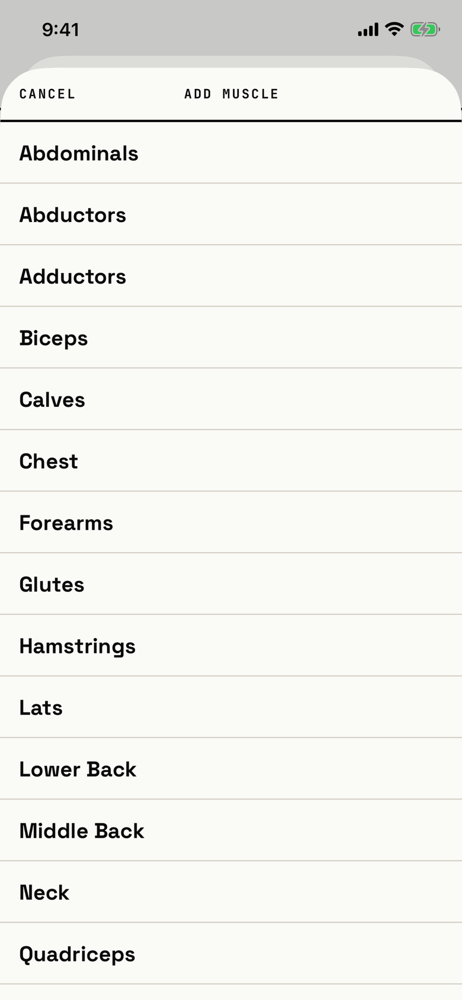

The lifter picks one of the 17 muscles to add to a custom exercise.

## Entry points

| From | Tap | Kind |
|---|---|---|
| [custom-exercise](custom-exercise.md) | + ADD MUSCLE | sheet |

The first muscle added becomes the primary; later ones are secondary.

## Exits

| Control | Goes to | Kind | Closes with |
|---|---|---|---|
| CANCEL | [custom-exercise](custom-exercise.md), unchanged | sheet | cancel |
| A muscle row | [custom-exercise](custom-exercise.md), with the muscle added | sheet | verb |
| A drag down | [custom-exercise](custom-exercise.md), unchanged | sheet | cancel |

## States

| State | How to reach it | Screenshot |
|---|---|---|
| Main: CANCEL, ADD MUSCLE, 17 muscle rows in name order from Abdominals | W01: editor > + ADD MUSCLE | [main](img/17e-default-light-muscle-picker.png) |
| A muscle already on the exercise: the row is still listed, and a tap closes the sheet without adding anything | Not captured: the tour picks Chest once | - |
| AX3, on both phones: the header puts ADD MUSCLE above CANCEL and the rows grow taller | Main launch at AX3 | [AX3](img/17e-ax3-light-muscle-picker.png), [Pro Max, AX3](img/17promax-ax3-light-muscle-picker.png) |

Dark mode and the Pro Max at default text change only colour and size: [dark](img/17e-default-dark-muscle-picker.png), [Pro Max](img/17promax-default-light-muscle-picker.png).

## Compared with the mock-up

No mock-up was drawn for the muscle picker.

## VoiceOver order

1. "Cancel"
2. "Add muscle"
3. "Abdominals"
4. "Abductors"
5. "Adductors"
6. Each other muscle in name order

Gaps: a muscle already on the exercise reads the same as the others, with no "added" state.
Rows are 52 pt tall and full width; CANCEL is 44 pt tall.

## Findings

<!-- findings are linked after the audit -->
