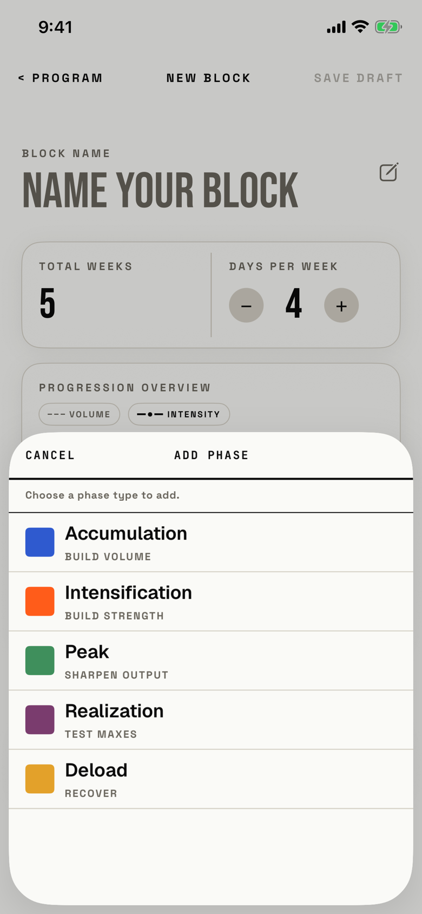

The lifter picks the type of phase to add to the end of the block.

## Entry points

| From | Tap | Kind |
|---|---|---|
| [new-block](new-block.md) | + ADD PHASE | sheet |

## Exits

| Control | Goes to | Kind | Closes with |
|---|---|---|---|
| CANCEL | [new-block](new-block.md) | sheet | cancel |
| A phase row, such as Peak | [new-block](new-block.md), with that phase added last | sheet | verb |
| Swipe down | [new-block](new-block.md) | sheet | none |

## States

| State | How to reach it | Screenshot |
|---|---|---|
| Five phase types | Main tour, active-block seed: a blank New Block, then + ADD PHASE | [17e light](img/17e-default-light-new-block-add-phase-type.png) |
| AX3 | Same walk at AX3; the title moves above CANCEL, the help wraps, and the half-height sheet shows two and a half rows | [17e AX3](img/17e-ax3-light-new-block-add-phase-type.png) |
| Pro Max, AX3 | Same walk at AX3; the title still moves above CANCEL, but the help fits one line, and the taller half-height sheet shows three and a half rows | [Pro Max AX3](img/17promax-ax3-light-new-block-add-phase-type.png) |

The list never changes: every type can be added any number of times.
Dark mode and the Pro Max at default text change only colour and size: dark mode lightens the swatches to their dark values ([17e dark](img/17e-default-dark-new-block-add-phase-type.png), [Pro Max](img/17promax-default-light-new-block-add-phase-type.png)).

## Compared with the mock-up

No mock-up was drawn for this sheet; the May builder mock-up adds a phase from a "+ ADD PHASE" text link with no picker shown.

## VoiceOver order

1. "Cancel"
2. "Add Phase"
3. "Choose a phase type to add."
4. "Accumulation, BUILD VOLUME"
5. "Intensification, BUILD STRENGTH"
6. "Peak, SHARPEN OUTPUT"
7. "Realization, TEST MAXES"
8. "Deload, RECOVER"

The subtitles are typed in capitals in the source (`fitbod/Periodization/BlockBuilderView.swift:2263`), so VoiceOver gets capital strings rather than words styled as capitals.
The colour swatches are not read, which is right, since each row names its type.

## Findings

<!-- findings are linked after the audit -->
